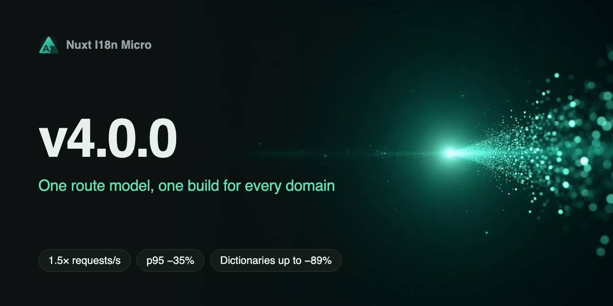

**التاريخ**: 2026-11-03

**الإصدار**: `v4.0.0`



صدر **v4.0.0**. أُعيدت كتابة التوجيه، ونواة الترجمة، وملفات القواميس، واكتشاف الـ locale، وكل حزم أطر العمل. تحتفظ الخيارات و`$t` و`$localePath` و`$switchLocale` والمكونات والـ composables بأسمائها. ما يتغير هو السلوك، ومعظم هذه التغييرات أخطاء اختفت. تحتاج معظم التطبيقات إلى تغييرات قليلة في الكود، لكن اقرأ [التغييرات الجذرية](#breaking-changes) قبل الترقية: انتقلت عناوين URL ووسوم SEO وواجهات API لحزم أطر العمل في بعض المواضع. تحتوي صفحة [الترقية](/ar/guide/upgrade) على كل التفاصيل.

## ما الجديد؟ {#what’s-new}

### بناء واحد لكل نطاق {#one-build-for-every-domain}

كان `locales[].baseUrl` و`baseDefault` يشكّلان الروابط فقط. أما الآن فيوجّهان الطلبات أيضًا، في الاستراتيجيات الأربع جميعها وفي `nuxt generate`:

```ts
export default defineNuxtConfig({
  i18n: {
    locales: [
      { code: 'en', baseUrl: 'https://example.com', baseDefault: true },
      { code: 'fr', baseUrl: 'https://example.com' },
      { code: 'de', baseUrl: 'https://example.de', baseDefault: true },
    ],
  },
})
```

- يخدم المضيف الـ locales الخاصة به. تصبح الروابط إلى locale نطاق آخر عناوين URL مطلقة على ذلك النطاق، ويؤدي التبديل إليه إلى الانتقال إلى هناك.
- يختار `trustForwardedHost` النطاق من `X-Forwarded-Host` خلف وكيل يستبدلها. معطَّل افتراضيًا.
- يمنح `NUXT_I18N_DOMAIN` الأمر `nuxt generate` مضيفه: شغّله مرة واحدة لكل نطاق، ويحتوي كل ناتج على صفحات ذلك النطاق وقواميسه فقط.
- التطبيق الذي لا يستخدم `baseUrl` لا يشحن أيًا من هذه الشيفرة.

راجع [الطبقات والنطاقات](/ar/guide/layers#multiple-domains) و[النشر](/ar/guide/deployment).

### توجيه يتوافق مع الموجِّه {#routing-that-agrees-with-the-router}

لم يعد البناء ووقت التشغيل يحسبان عناوين URL الموطَّنة كلٌّ على حدة. تأتي كل إجابة من المسارات التي ولّدها البناء، لذا لا يمكن لرابط أو مبدِّل لغة أو `hreflang` أو إعادة توجيه أن يشير إلى صفحة غير موجودة.

- الـ locale الذي لا يخدم صفحة يربط إلى صفحته الرئيسية، لا إلى صفحة locale آخر أبدًا.
- لا تسرد `hreflang` إلا الـ locales التي تخدم الصفحة.
- تُحَل `$switchLocale` إلى `true` أو `false`، لذا يمكنك معرفة متى فشل تحميل قاموس. ويعيد الاستدعاء المتكرر المحاولة.
- تصمد `$setI18nRouteParams` و`useI18nHead` المضبوطتان أثناء SSR بعد الإماهة. ويربط مبدِّل اللغة إلى الـ slug المترجم، في HTML الخادم أيضًا.
- يسري التنقل عندما يُثبَّت: التنقل الملغى أو المحظور لا يغيّر شيئًا.
- يعمل وضع الـ hash مع `prefix`.
- يضبط `<Greeting :locale="$getLocale()" />` على مكوّن خادم locale العرض الخاص به.

### اكتشاف locale واحد {#one-locale-detection}

ترتيب واحد في كل مكان، على الخادم، وفي المتصفح، وفي الدوال المساعدة لـ API الخادم، وفي Astro. يراعي `Accept-Language` قيم `q`، ولم تعد المطابقة الإقليمية تعتمد على ترتيب `locales`، ولا تعبر أبدًا بين أنظمة الكتابة الصينية. تصل تجاوزات وقت التشغيل الآن إلى التوجيه: يغيّر `NUXT_I18N_DEFAULT_LOCALE` و`disabledLocales` المحددة وقت التشغيل ما يُخدَم فعليًا. راجع [اكتشاف الـ locale](/ar/guide/locale-detection).

### قاموس واحد في كل وضع {#one-dictionary-in-every-mode}

كانت عمليات البناء المدمجة مسبقًا، و`mode: 'source'`، ووضع التطوير تختلف في صفحات كثيرة. أما الآن فتعطي القاموس نفسه.

- عمليات الدمج عميقة على كل مستوى، وتُتتبَّع سلاسل الاحتياط (`fr` → `de` → `en`) حتى نهايتها.
- تُطبَّق تعديلات الترجمة في وضع التطوير في مكانها، دون إعادة تحميل الصفحة. تختفي المفاتيح المُزالة، ويصل تعديل ملف الجذر إلى كل صفحة.
- تعيد `$clearCache()` تحميل الصفحة الحالية وتُبقي النص القديم على الشاشة حتى يصل النص الجديد.
- يُبقي الجزء الفاشل القاموس الحالي بدلًا من عرض المفاتيح الخام.

### ملفات قواميس أصغر {#smaller-dictionary-files}

- يحتوي ملف الصفحة الآن على ما يختلف عن جذر الـ locale فقط، في `__root/<locale>/data.json`. يحمّل المتصفح الجذر مرة واحدة ويدمج كل صفحة فوقه، فينخفض استخدام القرص ولا تكلّف الصفحة التالية إلا جزءًا من الأولى.
- تحمل عناوين URL للقواميس إصدارًا. يُثبَّت عنوان URL ذو `?v=` الحالي لمدة عام على خادم Node، وتجيب النسخة الثابتة لدى المضيف بـ `max-age=60`. راجع [ترويسات التخزين المؤقت](/ar/guide/deployment#cache-headers-and-datebuild).
- تحمّل كل صفحة SSR ملفات قاموسها مسبقًا، لذا تبدأ مع HTML.
- لم تعد القراءة الفاشلة عالقة: يقرأ الطلب التالي من جديد. راجع [عندما يتعذر قراءة قاموس](/ar/guide/deployment#when-a-dictionary-cannot-be-read).

### `<i18n-t>` وصيغ الجمع والتنسيقات بشكل أفضل {#better-&lt;i18n-t&gt;-plurals-and-formats}

- تعمل الـ slots مع `plural` و`number` و`date` و`relativeDate`، ويُملأ كل `{name}`، لا الأول فقط.
- `<i18n-t>` عارض واحد عبر Nuxt وVue وReact وPreact وSolid وAstro.
- الصيغة الأولى التي تبدأ بـ `=0 ` هي صيغة صفر صريحة، والبقية تتبع `Intl.PluralRules`: `=0 no apples | one apple | {count} apples`. راجع [`$tc`](/ar/api/methods#$tc).
- خيار جديد `timeZone`: تاريخ تقويمي واحد على الخادم وفي كل متصفح.
- `{firstName}` و`{first-name}` و`{user.name}` عناصر نائبة صالحة.
- تتبع `$tn` و`$td` و`$tdr` قيمة `iso`، كما تفعل صيغ الجمع.
- تعطي `$tdr` تواريخ مستقبلية حقيقية: `in 3 days`، أو `tomorrow` مع `numeric: 'auto'`.

### أكثر أمانًا افتراضيًا {#safer-by-default}

- يهرّب `<i18n-t html>` قيم `params`. الترجمة وحدها هي الترميز الموثوق.
- لا يغادر أي رابط الأصل عن طريق الخطأ: تبقى `//host` و`/\host` والقيم الفارغة على هذا الموقع.
- ذاكرة الترجمة المؤقتة على الخادم محدودة، لذا لا يمكن لعناوين URL ذات أسماء صفحات مختلقة أن تزيد الذاكرة.
- لا تقبل نقاط نهاية الحفظ في DevTools إلا ملفات `.json` الموجودة داخل مجلدات الترجمة لديك، وترفض الطلبات عبر المواقع.

### حزم أطر العمل عند 2.0 {#framework-packages-at-2-0}

- **React وPreact وSolid:** يأخذ `I18nT` خاصية `components` للنص المنسَّق. `useT` و`useLocaleSwitch` جديدتان، ودعم React Server Components عبر `@i18n-micro/react/server` و`/client`. لم يعد Preact يحتاج إلى `preact/compat`.
- **Vue وVitePress:** يحتفظ `I18nLink` بـ `name` و`query` و`hash`، ويحترم VitePress قيمة `base`.
- **Astro:** يحزم `i18nIntegration` قواميسك ويثبّت الـ middleware. لا تحتوي نقطة الدخول الرئيسية على أي استيراد `node:*`، لذا تعمل على الحافة. ويعمل `base`.
- **Node ووقت التشغيل:** تعطي `fork(locale)` نسخة رخيصة لكل طلب، وتقيّد `run(locale, fn)` في `@i18n-micro/node` نسخة بطلب.
- **`@i18n-micro/types-generator`:** بلا تبعيات خارجية، وplugin عادي لـ Vite وRollup.
- **`@i18n-micro/devtools-ui`:** تحديثات حية عبر socket الخاص بـ Vite، وتطبيق لشريط أدوات Astro.

### `@i18n-micro/cli` {#@i18n-micro/cli}

تعيش CLI الآن في المستودع الأحادي باسم `@i18n-micro/cli`، وأُعيدت كتابتها بـ 16 أمرًا بدلًا من 28 وبتبعيات أقل بكثير. يحل `check` محل `validate` و`diff` و`check-duplicates`، مع `--json` ورموز خروج لـ CI. عندما لا يستطيع `clean` إثبات أن مفتاحًا غير مستخدم، لا يكتب شيئًا. راجع [CLI](/ar/guide/cli).

### التوثيق {#documentation}

أُعيدت كتابة التوثيق انطلاقًا من الكود حول مسار قراءة واحد: التثبيت، فأول صفحة مترجمة، فملفات الترجمة، فالتوجيه، فالاكتشاف، ثم أدلة المهام. تُعاد توجيه عناوين URL القديمة. تسرد صفحة [الترقية](/ar/guide/upgrade) كل تغيير بالتفصيل.

## السرعة والحجم {#speed-and-size}

- يقرأ العرض على الخادم القواميس مباشرةً، دون طلب HTTP محلي ودون إعادة تحليل.
- لم يعد `dir="auto"` هو الافتراضي. تستهلك المتصفحات وقتًا طويلًا عليه في الصفحات الكبيرة: مع 20,000 عنصر `$t`، انخفض DOMContentLoaded في Chromium من نحو 980 ms إلى نحو 115 ms.
- لم يعد `serverTranslationPreload` و`i18n:register` يبطئان كل طلب.
- تُسقط حزمة العميل `useCookie` عندما لا يُضبط ملف تعريف ارتباط، وأصبح حجم `@i18n-micro/path-strategy` جزءًا من حجمه القديم.

**تطبيق اختبار مقابل v3.30.3.** تطبيق Nuxt مولَّد على خادم Node واحد، على جهاز Mac واحد، باستخدام `wrk` مع 24 اتصالًا لمدة 20 ثانية، وثلاث جولات متناوبة، على بناء ما قبل الإصدار. تأتي الصفوف من تشغيلات منفصلة، لذا قارن داخل الصف الواحد. تستخدم الإماهة `dir: 'ltr'` في الجانبين.

| المقياس | v3.30.3 | v4.0.0 |
| --- | ---: | ---: |
| 4 locales، كتالوج 10k: الطلبات في الثانية | 384-395 | 585-591 |
| 4 locales، كتالوج 10k: زمن الاستجابة p95 | 106-110 ms | 70-72 ms |
| 4 locales، كتالوج 10k: وقت معالج الخادم لكل طلب | 2.92-3.00 ms | 2.01-2.02 ms |
| 12 locale، كتالوج 100k: الطلبات في الثانية | 362-370 | 578-580 |
| 12 locale، كتالوج 100k: زمن الاستجابة p95 | 115-117 ms | 72-73 ms |
| 12 locale، كتالوج 100k: وقت معالج الخادم لكل طلب | 3.11-3.17 ms | 2.02-2.03 ms |
| الإماهة، صفحة 100k | 86-92 ms | 77-81 ms |
| JS العميل لهذا التطبيق، gzip | 105.1 KB | 93.9 KB |
| زمن الطلب مع مشترك في `i18n:register`، جزء 100k | 96-108 ms | 1.7 ms |

خدم تشغيل لمدة 30 دقيقة على كتالوج 100k، على بناء ما قبل إصدار أقدم، 1.13 مليون طلب دون أخطاء، وبقيت الذاكرة الحية مستقرة.

**ثلاثة تطبيقات إنتاجية مقابل v3.29.5،** الإصدار الذي كانت تعمل عليه، على بناء ما قبل الإصدار. اثنان منها مواقع SSR وواحد SPA. شُغّل كل منها على خادم Node واحد، لمدة 60 ثانية، مع 8 اتصالات، طلبات GET فقط، جولتان. وقت البناء تشغيل واحد لكل منها.

| المقياس | تطبيق SSR 1 | تطبيق SSR 2 | تطبيق SPA |
| --- | ---: | ---: | ---: |
| بايتات القواميس على القرص | من 6.37 MB إلى 1.52 MB (-76%) | من 4.43 MB إلى 1.52 MB (-66%) | من 15.40 MB إلى 1.69 MB (-89%) |
| حجم `.output` | -22% | -14% | -29% |
| وقت البناء | من 27 s إلى 22 s | من 23 s إلى 19 s | من 41 s إلى 28 s |
| JS العميل، gzip | +1.7% | +0.9% | +0.5% |
| الطلبات في الثانية | من 82 إلى 88 | من 237 إلى 240، ضمن هامش التشويش | من 233 إلى 404، هيكل SPA فقط |

**JS العميل.** يكسب التطبيق الحقيقي ذو الشيفرة الخاصة به قليلًا، كما سبق. نمت حزم أطر العمل أيضًا بسبب الإصلاحات المشتركة، وقد قيست بتطبيقات Vue وReact وPreact وSolid ذات حجم أدنى على بناء ما قبل إصدار آخر: نحو 1.4 KB إلى 2.5 KB gzip إضافية. كما تحمل React وPreact وSolid عارض النص المنسَّق المشترك.

**طلبات القواميس.** يتطلب التحميل الأول الآن ملفين، الجذر والصفحة. وتبقى بايتاته كما هي (+0.3% على 103 و89 تحميلًا أوليًا في تطبيقَي SSR). تتطلب الصفحة التالية في المستند نفسه ملفًا صغيرًا واحدًا: من 4.7 KB إلى 1.5 KB gzip ومن 5.9 KB إلى 0.5 KB gzip في الصفحتين المقيستين. وخلال تجوال مع تسجيل الدخول في تطبيق SPA، انخفضت بايتات القواميس بنسبة 21%.

**الحافة.** على تطبيق عرض توضيحي صغير، ارتفع رفع Cloudflare Worker من 241.5 KiB إلى 250.3 KiB gzip، على بناء ما قبل الإصدار. تستخدم القواميس المضمَّنة في حزمة Edge ملفات الجذر والصفحات نفسها، لكننا لم نقِس هذا التضمين على كتالوج كبير.

## التغييرات الجذرية {#breaking-changes}

### المتطلبات {#requirements}

- **Nuxt 3.18 أو أحدث**، و**Node 20 أو أحدث**.
- لم تعد **`@i18n-micro/test-utils`** تُثبَّت مع الوحدة. أضفها بنفسك إن كانت اختباراتك تستوردها.
- اختفت **`@i18n-micro/hmr`**: أصبح HMR للترجمة مدمجًا. أزل الحزمة إن كنت قد ثبّتها.
- تحتاج **`@i18n-micro/react`** إلى React 18 أو أحدث.
- حلّت `@i18n-micro/cli` محل **`nuxt-i18n-micro-cli`**.

### الخيارات والإعداد {#options-and-config}

- لم يعد `i18n-plugin-hooks` و`i18n-plugin-define` في `dependsOn` ينتظران أي شيء، دون أي خطأ. استخدم `i18n-plugin-loader`.
- الاستيرادات التلقائية على الخادم هي `useLocaleServerMiddleware` و`useTranslationServerMiddleware` و`loadTranslationsFromServer` و`detectCurrentLocale`. ولم يعد غيرها يُستورد تلقائيًا.
- اختفت `resolveTranslationPayloadMode` والدوال المساعدة الأخرى `resolveTranslationPayload*` من `nuxt-i18n-micro`، ومعها `shouldCopyTranslationPayloadsToPublic` و`shouldRegisterNitroServerAssets`. يبقى النوع `TranslationPayloadMode`.
- لم تعد `$getI18nConfig()` تحتوي على `isSSG` و`hmr` و`hooks` و`noPrefixRedirect` و`routeLocales` و`routeDisableMeta` و`globalLocaleRoutes`. أما الخيارات نفسها فلم تتغير.
- يوجّه `locales[].baseUrl` الطلبات الآن: يعيد locale نطاق آخر 404 على هذا المضيف، والروابط على المضيف نفسه نسبية. في مثل هذا البناء تحتوي `$getI18nConfig().locales` على ما يخدمه المضيف، وتحتوي `linkLocales` عليها جميعًا.
- يضبط `baseUrl` أيضًا الأصل على أي مضيف آخر: تستخدم canonical و`hreflang` القيمة `metaBaseUrl` إن ضُبطت، وإلا `baseUrl` للـ locale الافتراضي، لا أصل الطلب.
- تطابق `excludePatterns` مقاطع كاملة (لم تعد `'/admin'` تطابق `/administrator`)، والأنماط الشاملة مثبَّتة، وتصل أنماط `RegExp` الآن إلى وقت التشغيل.
- يعني عدم ضبط `cacheMaxSize` حدًا أقصى قدره 1000 إدخال على الخادم. تُحسب `cacheTtl` من وقت تخزين الإدخال، ولم تعد القراءات تمددها.
- مع `no_prefix` يبقى `localeCookie: null` الصريح في إعداد `i18n` معطَّلًا.
- مع `prefix_except_default` و`prefix_and_default` يُتجاهل `defaultLocale` المحدد وقت التشغيل مع تحذير. ويجب أن يكون `fallbackLocale` المحدد وقت التشغيل locale مفعَّلًا.
- يُحترم `routeDisableMeta` في `nuxt.config`، ويتغلب إدخال `nuxt.config` على `$defineI18nRoute` بأي صيغة للمفتاح.
- على الخادم في وضع التطوير، يكون الإعداد المحلول مجمَّدًا: الكتابة فيه ترمي خطأ.
- يتغلب إدخال `locales` في المشروع على إدخال الطبقة لـ `code` نفسه.

### الـ Composables ودوال `$` {#composables-and-$-methods}

- تُحَل `$switchLocale` إلى `true` أو `false`، بعد أن كانت لا تُحَل إلى شيء. ونوع `$switchRoute` هو `Promise<void>`.
- تربط `$localeRoute` و`$switchLocalePath` ومبدِّل اللغة الـ locale الذي لا يخدم صفحة إلى الصفحة الرئيسية لذلك الـ locale.
- تعيد `$localePath` السلسلة ذات المخطط `http(s):` أو `mailto:` أو `tel:` كما هي، وتحملها `$localeRoute` في `path` و`fullPath`. لا تمرر إليهما قيمة غير مفحوصة كهدف رابط. تبقى `//host` والأسماء المجردة مثل `x.com` مسارات على هذا الأصل.
- الرابط الذي لا مسار له يبقى في الصفحة الحالية: `$localePath('#top')` و`'?p=2'` و`''` و`{ query }`. كانت `'#top'` تُقرأ سابقًا من جذر الموقع. ولا تزال `'about'` المجردة تعني `/about`.
- تبقى `$switchRoute` داخل التطبيق. لا يغادره إلا `baseUrl` الخاص بالـ locale و`mailto:` و`tel:`.
- يمر الرابط إلى locale ذي `baseUrl` عبر `$localePath` أو `<i18n-link>`. تبقى `<NuxtLink :to="$localeRoute(x, 'fr')">` و`router.push($localeRoute(x, 'fr'))` مسارات لهذا التطبيق. في الكود استخدم `navigateTo($localePath(x, 'fr'), { external: true })`.
- تتبع `$switchLocaleRoute` وعمليات إعادة التوجيه `trailingSlash`.
- تُسقَط `$setI18nRouteParams` و`useI18nHead` المضبوطتان على الخادم عندما يغيّر التنقل المسار، بما في ذلك من `/news/1` إلى `/news/4`: اضبطهما مجددًا في الصفحة الجديدة.
- ترتبط `$setI18nRouteParams` المقروءة في setup بتلك الصفحة: الاستدعاء المتأخر من صفحة تم مغادرتها لا يفعل شيئًا. ليس لها دالة ضبط، لذا استبدل `useI18n` نفسها في الاختبارات.
- تعيد `useI18n()` كائنًا واحدًا لكل تطبيق. والكتابة فيه تصل إلى كل مستدعٍ.
- يتغير القاموس والـ locale والمعاملات والـ head عندما يُثبَّت التنقل. يرى `beforeResolve` أو `beforeRouteEnter` أو حارس عام لاحق القيم القديمة. ولا يتأثر route middleware.
- تستعيد `$switchLocale` الـ locale المخزَّن عند إلغاء تنقلها، في استراتيجيات URL.
- تُقحم `$t` قيمة `defaultValue`: تعطي `$t('missing', { n: 1 }, 'Got {n}')` النتيجة `Got 1`. وكذلك `$tc`، وعند الترجمة الفارغة تجيب بـ `''`.
- تحترم `$has(key, route)` المسار.
- تعيد `$clearCache()` تحميل قاموس الصفحة الحالية.
- لا يقرأ العنصر النائب `{param}` إلا المعاملات التي تمررها: يبقى `{constructor}` كما كُتب.
- تأخذ `$tc` مع عدد سالب أو كسري أو ضخم الصيغة الأخيرة مع العدد الحقيقي. لم تعد `{ count: null }` ترمي خطأ، ويصل مفتاح الجمع المفقود إلى معالج المفاتيح المفقودة.
- تعطي `$tdr` القيمة `Invalid Date` لمدخل غير صالح. وما هو أقل من ثانية في الماضي يكون `0 seconds ago`.
- تتبع `$tn` و`$td` و`$tdr` قيمة `iso`: ينسّق `{ code: 'en', iso: 'en-GB' }` التواريخ بصيغة `31/10/2026`. الرمز الذي لا يعرفه `Intl` يُنسَّق كـ `en`، وصيغ الجمع حسب قاعدة الفهرس: اضبط `iso` (`{ code: 'ua', iso: 'uk-UA' }`).
- `detectCurrentLocale` مهملة: استخدم `useLocaleServerMiddleware(event).current`.

### صيغ الجمع {#plurals}

تحتفظ القوالب بمعناها، باستثناء واحد. صيغة صفر بلا عنصر نائب، ثم صيغة واحدة لكل فئة، مع `{count}` في كل صيغة تتشاركها عدة أعداد، تتبع الآن الفئة في الـ locales ذات ثلاث فئات أو أكثر (`ru` و`uk` و`pl` و`cs` و`ar` وغيرها): تعطي `none | {count} one | {count} few | {count} many` النتيجتين `3 few` و`21 one` في `uk`. لاستخدام الفئات في أي قالب آخر، أضف العلامة `=0 `. تقرأ قاعدة `plural` المخصصة القيمة الخام، لذا يصلها القالب الموسوم مع `=0 ` في مكانها. راجع [الجدول في صفحة الترقية](/ar/guide/upgrade#plurals-and-formatting).

### المكونات {#components}

**`<i18n-t>`**

- يهرّب `html` قيم `params` في كل الحالات ويتجاهل جميع الـ slots.
- يتغلب الـ slot على الـ param الذي يحمل الاسم نفسه.
- تعني `null` عدم الضبط لـ `plural` و`number` و`date` و`relativeDate`.
- يعدّ `plural` كما تفعل `$tc`، باستخدام `Number`: تبقى `1.5` هي `1.5`، و`"2 items"` هي `NaN`، و`""` هي `0`.
- تحتفظ `number` و`date` و`relativeDate` بقيم `params`.
- يُطبَّق `hideIfEmpty` في كل فرع، ويحل `defaultValue` محل المفتاح المفقود في كل فرع.
- المفتاح المفقود مع `html` نص مهرَّب.
- يحمل ناتج `date` و`relativeDate` السمة `data-allow-mismatch="text"`، وبجانب slot مسمّى يكون النص في `<span>` خاص به.
- تُسقَط السمتان `.innerHTML` و`textContent`.
- إنه مكوّن وظيفي: لا يعطي `ref` عليه أي نسخة.
- يقرأ `<i18n-t>` و`<i18n-group>` القاموس النشط، كما تفعل `$t`.

**`<i18n-switcher>`**

- الرابط عنصر `<a>` عادي يستدعي `$switchLocale`، لذا اختفت classes `router-link-active`.
- الزر من نوع `type="button"` مع `aria-expanded`. ويغلق Escape والنقر خارجها القائمة المنسدلة.
- classes جديدة `i18n-switcher-wrapper` و`i18n-switcher-dropdown` و`i18n-switcher-button`. يحمل كل رابط `lang`، و`dir` عندما يضبطه الـ locale.
- تستخدم الأنماط الافتراضية خصائص CSS منطقية، وللقائمة المنسدلة `z-index` أكبر وعرض أدنى وظل.
- يعيد الخادم كتابة روابطها عند انتهاء العرض، في الصفحات ذات المعاملات. لا يُعاد كتابة رابط `$switchLocalePath` المكتوب يدويًا.

**`<i18n-link>`**

- تُطابَق `https://` و`mailto:` و`tel:` بأي حالة أحرف. `report.pdf` المجردة مسار، و`example.com` تبقى خارجية. لاحقة الملف التي هي أيضًا نطاق علوي (`example.md`) تُعدّ ملفًا: اكتب `https://`.
- يتجاهل `activeStyle` الشرطة المائلة اللاحقة والاستعلام والـ hash.

### الـ Hooks والأنواع {#hooks-and-types}

- `i18n:register` هو hook لوقت التشغيل: `nuxtApp.hook('i18n:register', …)` في plugin.
- أُعيدت تسمية النوع المُصدَّر `ModuleHooks` إلى `ModuleRuntimeHooks`.
- لم يُطلق `i18n:beforeLocaleSwitch` و`i18n:afterLocaleSwitch` قط ولم يعودا موثَّقين.
- أصبح `ModuleOptionsExtend.isSSG` اختياريًا ومهملًا: لا شيء يضبطه.

### عناوين URL وإعادة التوجيه {#urls-and-redirects}

- **تعيد `/en` و`/en/...` الرمز 404** مع `prefix_except_default`، حين يكون `en` هو الافتراضي.
- **تعيد بادئة locale بحالة أحرف أو تهجئة أخرى 404** (`/DE/about`). وكذلك `/DE/x` مع `[...slug]` و`/DE` بجانب `[slug]`، لذا يفقد slug في CMS يساوي رمز locale بحالة أحرف أخرى صفحته.
- **يبقى عنوان URL المجهول 404** مع `autoDetectPath: '*'` أو `'no_prefix'`. تحتفظ `prefix` بإعادة التوجيه، وكذلك `/` في كل مكان.
- **المسار المخصص لـ locale آخر، بلا بادئة،** يعيد `302` إلى عنوان URL للـ locale الافتراضي مع `prefix_except_default`. ومع `prefix` تصل إعادة التوجيه الآن إلى صفحة حية. وتبقى `prefix_and_default` تعيد 404.
- **`prefix` مع `redirects: false`** تجيب بـ 404 على عنوان URL بلا بادئة، بما في ذلك عنوان URL الأصلي لصفحة ذات مسار افتراضي مخصص.
- **`autoDetectPath: '*'`** يطبّق ملف تعريف الارتباط و`Accept-Language` على المسارات بلا بادئة أيضًا.
- **مع `prefix`** يحتفظ عنوان URL بلا بادئة بـ locale الزائر، على كل مسار، أيًا كانت قيمة `autoDetectPath`.
- **مع `prefix_and_default`** يكون عنوان URL بلا بادئة هو الـ locale الافتراضي.
- **مع `no_prefix`** يعرض المسار المخصص الـ locale الخاص به، وتُعرض الصفحة المقيَّدة بـ locale تخدمه، والـ locales التي تتشارك مسارًا تتشارك سجلًا واحدًا.
- **إعادة توجيه `routeRules` بلا صفحة** غير موطَّنة: تعيد `/de/old` الرمز 404، بعد أن كانت 200 فارغة.
- **تصل قواعد المسارات إلى المسارات المخصصة،** وتُنسخ مع `no_prefix` أيضًا. يطابق شقيق ثابت مثل `/de/artikel/news` النمط `/de/artikel/:slug`.
- **الـ locale ذو `disabled: true`** يجيب بـ 404 على بادئته فورًا، وتبقى الروابط إليه في الصفحة.
- **مسار صفحة بحالة أحرف أخرى** يعيد `302` إلى تهجئته الخاصة: تذهب `/T/BASIC` إلى `/t/basic`.
- **عنوان URL الأصلي لصفحة ذات مسار افتراضي مخصص** يعيد `302` إلى ذلك المسار مع `prefix_except_default`. كان يعيد 404.
- **`noPrefixRedirect`** يتبع locale الزائر: مع ملف تعريف الارتباط `de`، تذهب `/about` إلى `/ueber-uns`، لا إلى مسار الـ locale الافتراضي.
- **البادئة الخاصة بالمضيف** تعيد 404 على مضيف `baseDefault` الخاص بها مع `prefix_except_default`: كانت `/de/x` على مضيف `de` تعيد 200.
- **`customRegexMatcher`** لم يعد يعيد 404 لصفحة حقيقية يشبه مقطعها الأول locale.
- **`nuxi generate`** يصيّر مسبقًا كل صفحة ثابتة في كل locale يخدمها، ما لم تضبط قاعدة مسار `prerender: false`: ملفات أكثر في المخرجات. مع `baseUrl`، شغّله مرة واحدة لكل نطاق مع `NUXT_I18N_DOMAIN`.
- **تحتفظ إعادة التوجيه على العميل بنمط تنقلها:** يضيف `<NuxtLink>` العادي إدخالًا في السجل.
- **أسماء المسارات الموطَّنة متسقة.** لا يتأثر إلا الكود الذي يكتب أسماء `localized-…` مباشرةً في `router.push({ name })`: مرّر اسم الصفحة نفسه إلى `$localeRoute`.
- **الصفحات غير المسماة من `extendPages`** تُوطَّن وتحصل على اسم.
- **مع `prefix`، يحتفظ الرابط إلى نطاق آخر** ببادئة الـ locale.
- **الصفحة الرئيسية للنطاق** تُكتب بلا شرطة مائلة لاحقة في كل مكان.
- **`?locale=`** لا يُحتسب في الصفحات إلا مع `no_prefix`. لم تعد `/about?locale=de` تعرض الألمانية تحت `lang="en"`.
- **`setLocale('de')` من plugin** على `/en/...` لم يعد يحمّل قاموس `de`.

### SEO ومخرجات HTML {#seo-and-html-output}

- لم يعد `dir="auto"` هو الافتراضي. تحصل اللغة المعروفة من اليمين إلى اليسار على `dir="rtl"`، ولا يحصل أي locale آخر بلا `dir` على أي سمة. للاحتفاظ بالمخرجات القديمة اضبط `dir: 'auto'`، مع تكلفة تحليل في الصفحات الكبيرة. راجع [اتجاه النص](/ar/guide/seo#text-direction).
- يعمل `disableMeta` الآن: لا تحتوي الصفحة على `hreflang` أو canonical أو `og:locale`. ويبقى `lang` و`dir`.
- لا تسرد `hreflang` إلا الـ locales التي تخدم الصفحة. ولا يظهر `x-default` إلا عندما يخدمها الـ locale الافتراضي.
- الصفحة غير الموطَّنة لا تحتوي على `hreflang` أو `og:locale:alternate`.
- تحمل صفحات 404 `<html lang dir>` بـ locale عنوان URL، ولا canonical ولا `hreflang`.
- تحتفظ canonical و`og:url` و`hreflang` باستعلام مدرج في القائمة البيضاء (`/about?page=2`)، على الخادم أيضًا.
- تتضمن canonical و`hreflang` القيمة `app.baseURL` عندما يأتي الأصل من الطلب.
- تحتوي كل صفحة SSR على `<link rel="preload" as="fetch" crossorigin="anonymous">` لملفات قاموسها، وصفحات 404 أيضًا. اسمح به في CSP صارمة. مع `apiBaseClientHost` يحتاج ذلك المضيف إلى CORS.
- تُضبط `Vary` على كل صفحة مع `no_prefix`، وعلى عمليات إعادة توجيه الـ locale في الاستراتيجيات الأخرى. تحقق من مفتاح التخزين المؤقت في CDN لديك.
- لا يُكتب ملف تعريف ارتباط الـ locale إلا بواسطة صفحة مخدومة.

### الاكتشاف والخادم {#detection-and-server}

- يراعي `Accept-Language` قيم `q`، وتستبعد `q=0` اللغة.
- تستخدم `useLocaleServerMiddleware` و`useTranslationServerMiddleware` ترتيبًا واحدًا في كل مسار (`?locale`، أو المعامل `[locale]` أو البادئة، ثم ملف تعريف الارتباط، ثم الترويسة، ثم الافتراضي)، وتحترمان `localeCookie: null` و`autoDetectLanguage: false`، وتخزنان قاموسًا لكل locale مؤقتًا.
- يُتجاهل ملف تعريف ارتباط الـ locale المشوَّه ويُترك كما هو، بدلًا من إفشال SSR.
- لا يقرأ وضع الـ hash إلا ملف تعريف الارتباط `hash-locale`. لم يعد `user-locale=de` وحده يُحتسب.
- يغيّر `NUXT_I18N_DEFAULT_LOCALE` و`disabledLocales` المحددة وقت التشغيل التوجيه.
- **تغيّرت مخرجات `premerged`.** يحتوي `/{apiBaseUrl}/<page>/<locale>/data.json` على ما يختلف عن `__root/<locale>/data.json` فقط. يجب على أي شيء يقرأ تلك الملفات مباشرةً أن يدمج الاثنين. ولا يزال القاموس الكامل ملفًا صالحًا.
- **تتبع القواميس `app.cdnURL`.** يجلبها المتصفح من `<cdnURL>/_locales/...`، حيث كان يستخدم `app.baseURL`. يجب أن تحتوي CDN على `_locales/` وأن تسمح بأصل موقعك. راجع [App baseURL ومضيفات الحمولات](/ar/guide/deployment#app-baseurl-and-payload-hosts).
- لا ذاكرة مؤقتة لمسارات Nitro على `/{apiBaseUrl}/**`، واختفت الترويسة `s-maxage=60, stale-while-revalidate`. إن كنت تعتمد على تلك الذاكرة، فضع CDN أمام مسار الحمولة.
- يجيب `/{apiBaseUrl}/<page without a folder>/<locale>/data.json` بقاموس الجذر، بعد أن كان `{}`. يمر الآن 404 الخاص بالمضيف كـ 404، حيث كان يجيب بـ `200 {}`.
- يفشل التصيير المسبق الذي لا يستطيع تحميل قاموسه بـ 500 وتحذير، ومع `failOnError` الافتراضي في Nuxt يخرج البناء بالرمز 1.
- لا تصل الترجمة المتغيرة دون إعادة بناء إلى المتصفح إلا عندما يتغير `v`: اضبط `NUXT_I18N_DATE_BUILD`.
- لم يعد SSR يطلب `/{apiBaseUrl}` عبر HTTP، ما لم يُضبط `apiBaseServerHost`.

### الترجمات {#translations}

- عمليات الدمج عميقة على كل مستوى، وتُتتبَّع سلاسل الاحتياط حتى نهايتها.
- يتم الدمج حسب الـ locale: يتغلب ملف الجذر للـ locale النشط على ملف الصفحة للـ locale الاحتياطي.
- تقرأ الصفحة التي لا تملك مجلد `pages/<name>/` خاصًا بها قاموس الجذر في الإنتاج. كانت تحصل سابقًا على `{}`.
- يقرأ `disablePageLocales: true` ملفات الجذر فقط.
- تتوقف مفاتيح الصفحة المغادِرة عن الحل بعد التنقل. إن استخدم layout مفاتيح لم تكن إلا في ملف الصفحة السابقة، فانقلها إلى ملف الجذر.
- يحذّر ملف الـ locale المعطوب مرة واحدة مع مساره في كل وضع. كان وضع التطوير يرمي خطأ سابقًا.

### حزم `@i18n-micro/*` {#@i18n-micro/*-packages}

كل حزم `@i18n-micro/*` عند الإصدار 2.0.0، بما فيها `@i18n-micro/types` و`@i18n-micro/cli` الجديدة.

**`@i18n-micro/react`, `preact`, `solid`**

- انتقلت محوِّلات الموجِّه إلى `/router`: `createReactRouterAdapter` و`createSolidRouterAdapter` و`createBrowserHistoryAdapter` الخاصة بـ Preact. أُزيلت `createPreactRouterAdapter`.
- يتبع `I18nT` ما ورد عن `<i18n-t>` أعلاه. تُسقَط السمات `dangerouslySetInnerHTML` و`innerHTML` و`textContent`.
- يعرض `I18nSwitcher` عناصر `<a href>` مع `aria-current="page"` و`▾` وCSS منطقية و`language-switcher` على الزر. لا `aria-haspopup`. يُضاف `className` إلى `i18n-switcher-wrapper`.
- الرابط إلى `/` أو جذر locale نشط عند التطابق التام فقط (React وPreact).
- يحتفظ `I18nLink` بـ `onClick` و`style` اللذين يضبطهما المستخدم، ويترك النقرة المعدَّلة للمتصفح. لا يُحتسب الاستعلام والـ hash في فحص النشاط. وبدون موجِّه، لا يكون أي رابط نشطًا.
- React وPreact: أصبحت `I18nLocalesContext` و`I18nDefaultLocaleContext` و`I18nRouterContext` سياقًا واحدًا هو `I18nConfigContext`. Solid: يحتوي `I18nContext` واحد على `{ i18n, locales, defaultLocale, router }`.
- تتضمن `getCurrentPath` في المحوِّلات الاستعلام والـ hash، والمفتاح المكرر في `getRoute().query` مصفوفة.
- يحتفظ `I18nProvider` المتداخل بلا `i18n` بالنسخة الخارجية، ويرمي المزوِّد الذي لا نسخة له على الإطلاق خطأ.
- `defaultLocale()` بلا قيمة هي `fallbackLocale`.
- Solid: أُزيلت `getCurrentPathAccessor`. لم تعد `useI18n()` ترمي خطأ بدون `locales`.
- React: لم تعد `use-sync-external-store` تبعية، و`react-dom` تبعية نظيرة اختيارية.

**`@i18n-micro/vue`, `vitepress`**

- `I18nT` مكوّن وظيفي.
- يتبع `I18nSwitcher` و`I18nLink` الأقسام أعلاه. اختفت `aria-haspopup`.
- يحل `I18nLink` و`createVueRouterAdapter` قيم `name` و`query` و`hash`. يرمي `name` المجهول خطأ، كما يفعل `RouterLink`.
- لم تعد `useLocaleHead` تبني `//de/`. تتوافق canonical و`hreflang` للصفحة الواحدة (`/de`)، وتصل إليهما معاملات الاستعلام المدرجة في القائمة البيضاء.
- قد تتلقى `I18nRoutingStrategy.resolvePath` كائن موقع ومسارًا مع استعلام وhash. و`toHref` اختيارية جديدة.
- VitePress: تحمل الروابط ومبدِّل اللغة و`push` و`replace` القيمة `site.base`.

**`@i18n-micro/astro`**

- يحزم `i18nIntegration` قيمة `translationDir` ويثبّت الـ middleware: احذف `src/middleware.ts` الذي لا يفعل سوى نسخ الإعداد، أو مرّر `middleware: false`. أما `src/middleware.ts` الخاص بك فيمرر `base: config.base`.
- يرمي `i18nIntegration` خطأ عند `messages` و`plural` و`missingHandler` و`routingStrategy`: مرّرها إلى `createI18n` أو `createI18nMiddleware`، مع `middleware: false`. وأُزيلت من نوعه الخيارات التي لم تكن تفعل شيئًا قط.
- انتقلت `loadTranslationsFromDir` و`loadTranslationsIntoI18n` إلى `@i18n-micro/astro/node`، وهي بصيغة ESM فقط.
- أُزيلت `getGlobalRoutingStrategy` و`setGlobalRoutingStrategy` و`runWithRoutingStrategy`: اقرأ `Astro.locals.routingStrategy`.
- أصبحت `clone()` هي `fork()`، واختفى الخيار `_storage`.
- الصفحات الديناميكية مسار واحد: `/blog/hello` هي `blog-slug`، بعد أن كانت `blog-hello`. انقل `pages/blog-hello/` إلى `pages/blog-slug/`. تتلقى `getRouteName` المخصصة النمط كوسيط ثالث.
- يحدد عنوان URL locale الصفحة. `autoDetect` هو 302 من `/` إلى الصفحة الرئيسية للـ locale المفضل. خيار `localeCookie` جديد، و`redirectToDefault` مُنفَّذ.
- عرض صفحة قادمًا من صفحة من الأصل نفسه بـ locale آخر يكتب ملف تعريف ارتباط الـ locale ولا يعيد التوجيه. لا تعيد جزر الخادم والإجراءات التوجيه أبدًا وتحمل `Vary: Referer`.
- يستبعد `config.localeCodes` الـ locales المعطَّلة، وتجيب `prepareLocaleRewrite` بـ 404 لها.
- ترسل `getI18nProps()` بلا مفاتيح كل ما يمكن لـ `t()` الإجابة عنه في الصفحة، مع تحذير في وضع التطوير فوق 20 KB. مرّر المفاتيح التي تستخدمها الجزيرة.
- `useLocaleHead`: قيمة `baseUrl` الافتراضية هي `site`، وإلا فنسبية إلى الجذر. تحمل الروابط ووسوم meta قيمة `id`.
- يهرّب `<I18nT html>` قيم `params`، وتُعرض الترجمة الفارغة فارغة.
- يترك `<I18nLink>` و`localizePath` عناوين URL الخارجية و`#hash` و`?query` كما هي ويحتفظان بالشرطة المائلة اللاحقة.
- يحتفظ `<I18nSwitcher>` بالاستعلام ويستخدم `data-i18n-switcher` بدلًا من المعرّفات المولَّدة.
- لا تحتوي `@i18n-micro/astro/client` إلا على `translate` و`hasTranslation`: استورد المحوِّلات من `/client/vue` و`/client/react` و`/client/preact` و`/client/svelte`. يحتاج `client/vue` إلى تثبيت `vue`.
- الجزر: تكون `has()` صحيحة لشجرة فرعية، و`t('')` هي `''`. تأخذ `provideI18n` دالة getter لتتبع الخصائص الجديدة.
- ترمي `getLocale` و`getDefaultLocale` خطأ بدون الـ middleware.

**`@i18n-micro/runtime`, `node`**

- الكتابة في locale ليس نشطًا ولا احتياطيًا لا تُخطر المشتركين.
- يستبدل `addRouteTranslations(locale, route, messages, false)` الجزء.
- يجلب `loadFromUrls` بالتوازي ولا يكتب شيئًا إن فشل أحدها.
- Node: تبدّل `reload()` القواميس بدلًا من إفراغها أولًا، ولا تسجّل رسالة نجاح. المجلد الذي اختفى يحتفظ بالقواميس القديمة.
- Node وAstro وVitePress: قارئ واحد لمجلد locales. يحذّر المجلد المفقود، ويُبلَّغ عن الملف الذي ليس كائن JSON ويُتخطى، وتبدأ الرسائل بـ `[i18n]`.

**`@i18n-micro/test-utils`**

- تتبع المحاكاة قواعد الترجمة الحقيقية: تأخذ `tc('a', 1.5)` الصيغة الأخيرة، و`td('nope')` هي `Invalid Date`، و`t(miss, undefined, '')` هي المفتاح، ولم يعد المفتاح المفقود يُسجَّل.
- اختفى `isolated` من `createI18nTestContext`، وأُزيل `./publish-smoke`.

**`@i18n-micro/types-generator`**

- `I18nTypesPlugin(options)` هو plugin عادي لـ Vite وRollup: لا `.vite()` ولا `.webpack()` ولا `.esbuild()`. لـ webpack أو esbuild، استدعِ `generateTypes` في سكربت.
- `getTypesString` و`generateTypes` متزامنتان. أُزيلت `flattenKeys` و`isPlainTranslationObject`.
- المفاتيح هي ما تقرؤه `t()`: تُضاف مسارات الكائنات، وتُستبعد الملفات خارج تخطيط الـ locale.

**`@i18n-micro/devtools-ui`**

- لا يقبل الحفظ إلا ملف `.json` موجودًا داخل `translationDir`، ولم يعد ينشئ ملفات. الطلب عبر المواقع يعيد 403.
- يرمي الحفظ الفاشل إلى نقطة نهاية قابلة للوصول خطأ ويتراجع.
- تأخذ `createBridge` خيار `base`. يستخدم Astro `i18nDevToolsIntegration`.

**`@i18n-micro/utils`, `core`, `path-strategy`, `route-strategy`**

للمحوِّلات المخصصة والأدوات فقط.

- `utils`: أُزيلت المسارات الفرعية `./route` و`./route-pattern` و`./build` و`./payload-stats` و`./payload-config`، ومعها `resolveServerLocale` و`resolvePreferredLocale`: استدعِ `resolveLocale`. اختفت `deepMergeTranslations` و`mergeRouteTranslationsWithRoot`: استخدم `deepMergeTranslationsRecursive`.
- `core`: يُسقط `TranslationHelper` الدوال `setCache` و`getGeneration` و`lookupIn` (استخدم `lookup(chunkKey, key)`). ويُسقط `BaseI18n` الدالتين `ensurePinnedChunk` و`invalidatePin`. اختفت `useTranslationHelper(storage)`: استخدم `new TranslationHelper(storage)`.
- `path-strategy`: **أصبحت `switchLocaleRoute(fromLocale, toLocale, route, options)` الآن `switchLocaleRoute(toLocale, route, options)`. الاستدعاء القديم في JavaScript يعيد نتيجة خاطئة دون أي خطأ.** لا تتأثر `$switchLocaleRoute` في Nuxt. اختفت نقاط الدخول `/prefix` و`/no-prefix` و`/prefix-except-default` و`/prefix-and-default`، وكذلك `getRedirect` و`getCanonicalPath`. يحتاج `RouterAdapter` إلى `getRoutes`. لا تبني `createPathStrategy` عناوين URL مطلقة: استخدم `new DomainPathStrategy(ctx)` عندما تملك الـ locales قيمة `baseUrl`.
- `route-strategy`: لا يُصدَّر إلا `RouteGenerator` و`generateRoutes` و`Rules` والدوال المساعدة للمسارات.

## الانتقال {#migration}

1. تحقق من المتطلبات: Nuxt 3.18، وNode 20، وReact 18 إن كنت تستخدم `@i18n-micro/react`.
2. حدّث `nuxt-i18n-micro` وكل حزم `@i18n-micro/*` معًا. أزل `@i18n-micro/hmr`. أضف `@i18n-micro/test-utils` كتبعية تطوير إن كانت اختباراتك تستوردها. استبدل `nuxt-i18n-micro-cli` بـ `@i18n-micro/cli` واتبع [جدول أوامرها](/ar/guide/cli#moving-from-nuxt-i18n-micro-cli).
3. ابحث في الكود عن `switchLocaleRoute(` من `@i18n-micro/path-strategy`، و`i18n-plugin-hooks`، و`i18n-plugin-define`، وأسماء المسارات `localized-`، و`$getI18nConfig().globalLocaleRoutes` ومفاتيح الإعداد المُزالة الأخرى، و`ModuleHooks`، و`@ts-expect-error` على `i18n:register`.
4. انقل الترميز من معاملات `<i18n-t html>` إلى الترجمة، ومرّر البيانات كمعاملات.
5. إن كنت تضبط `baseUrl`: راجع الروابط المبنية باستخدام `$localeRoute`، واضبط `trustForwardedHost` خلف وكيل، وشغّل `nuxi generate` مرة واحدة لكل نطاق مع `NUXT_I18N_DOMAIN`.
6. تحقق من عناوين URL مقابل استراتيجيتك: `/en` مع `prefix_except_default`، وslugs CMS التي تشبه الـ locales، وعمليات إعادة التوجيه في `routeRules`، و`excludePatterns`.
7. تحقق من مفتاح التخزين المؤقت في CDN بخصوص `Vary`، واسمح برابط التحميل المسبق في CSP صارمة. مع `app.cdnURL`، ضع `_locales/` على CDN واسمح بـ CORS.
8. إن كانت أداة تقرأ ملفات `/_locales/...` مباشرةً، فادمج ملف الصفحة فوق `__root/<locale>/data.json`.
9. إن كان حارس عام يقرأ الـ locale أو القاموس، فتأكد من أنه يمكن أن يعمل قبل تثبيت التنقل. انقل المفاتيح التي أخذها layout من ملف الصفحة السابقة إلى ملف الجذر.
10. قارن مخرجات `nuxi generate` أو زحف خريطة الموقع قبل وبعد: تتغير `hreflang` و`x-default` وcanonical وقائمة الصفحات عن قصد.
11. حدّث الاستيرادات لحزم أطر العمل: `/router` لمحوِّلات React وSolid وPreact، و`/node` لمحمِّلات Astro، و`I18nTypesPlugin(o)` لـ plugin الأنواع.
12. في Astro، احذف `src/middleware.ts` الذي لا يفعل سوى نسخ الإعداد، وأعد تسمية القواميس بنمط `pages/blog-hello/` إلى نمطها.
13. حدّث الاختبارات التي ثبّتت `router-link-active` أو `li button` أو `▼` أو سلوك المحاكاة القديم.

التفاصيل وكل الحالات الحدية: [الترقية](/ar/guide/upgrade).

## لماذا يهم ذلك {#why-it-matters}

- **صحيح بالبناء:** تأتي الروابط وعمليات إعادة التوجيه ووسوم SEO من المسارات التي يملكها التطبيق فعلًا.
- **إجابة واحدة في كل مكان:** يعطي البناء ووضع المصدر ووضع التطوير القاموس نفسه، ويستخدم كل مستدعٍ ترتيب اكتشاف واحدًا.
- **النطاقات:** نشر واحد لكل نطاقات الـ locale، دون بناء ثانٍ.
- **إعدادات افتراضية أكثر أمانًا:** معاملات مهرَّبة، وذاكرات مؤقتة محدودة، وروابط تبقى على أصلك.
- **أقل للشحن:** ملفات قواميس أصغر، وحزم توجيه أصغر، ومنطق مشترك في مكان واحد.

للاطلاع على القائمة الكاملة للتغييرات، راجع [الترقية](/ar/guide/upgrade) و[سجل التغييرات](https://github.com/s00d/nuxt-i18n-micro/blob/main/CHANGELOG.md).

---
