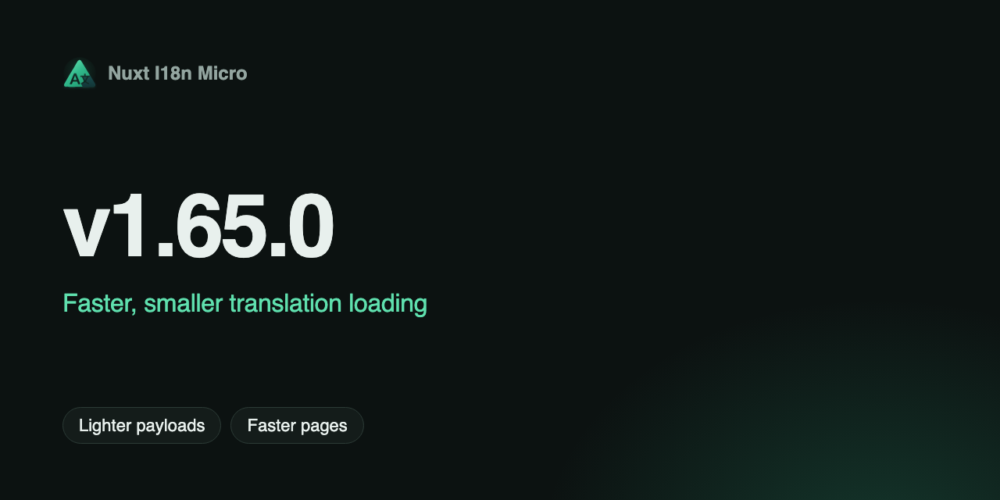

**Data**: 2025-01-20

**Versió**: `v1.65.0`

Ens fa molta il·lusió anunciar la **v1.65.0**, amb una **reescriptura completa de la lògica central** per a un millor rendiment i mantenibilitat! Aquesta versió inclou un suport millorat de TypeScript, redirecció d'idioma al costat del client i una gestió de traduccions més àgil. Actualitzeu ara per gaudir d'una experiència més fluida i ràpida! 🚀

[Més informació](https://github.com/s00d/nuxt-i18n-micro/blob/main/CHANGELOG.md#v1650)
