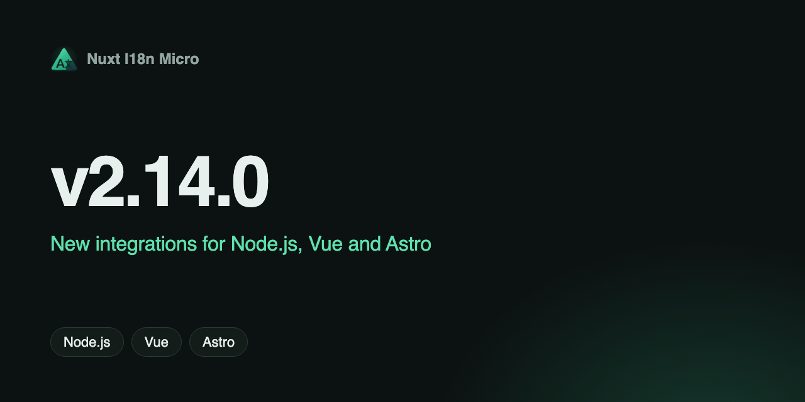

**Data**: 2025-12-07

**Versió**: `v2.14.1`

Ens fa il·lusió anunciar la **v2.14.1** amb integracions totalment noves per a Node.js, Vue 3 i Astro! Aquests paquets porten les mateixes potents capacitats d'i18n als vostres frameworks preferits i comparteixen la mateixa lògica central per a més coherència i rendiment.

## Què hi ha de nou? {#what’s-new}

- **@i18n-micro/node** - Feu servir traduccions i18n en qualsevol aplicació Node.js, eina de CLI o servei de backend
- **@i18n-micro/vue** - Plugin de Vue 3 per a la internacionalització amb traduccions reactives i suport per a rutes específiques
- **@i18n-micro/astro** - Integració d'Astro per a la internacionalització amb suport complet de TypeScript
- **@i18n-micro/types-generator** - Generació automàtica de tipus TypeScript per a les claus de traducció amb seguretat de tipus completa i autocompletat a l'IDE

## Característiques principals {#key-features}

Totes les integracions comparteixen els mateixos avantatges bàsics:

- Lleugeres i amb bon rendiment
- Suport per a traduccions específiques de ruta
- Pluralització integrada
- Format de números, dates i temps relatiu
- Suport complet de TypeScript
- La mateixa estructura de fitxers de traducció JSON

El **Types Generator** ofereix millores addicionals per a l'experiència del desenvolupador:

- Generació automàtica de tipus a partir dels fitxers de traducció JSON
- Claus de traducció amb seguretat de tipus i validació en temps de compilació
- Suport complet d'autocompletat a l'IDE
- Recàrrega en calent quan canvien els fitxers de traducció
- Cap sobrecost en temps d'execució

Per a documentació detallada i exemples, visiteu el [repositori](https://github.com/s00d/nuxt-i18n-micro) o consulteu la [documentació](https://s00d.github.io/nuxt-i18n-micro/).

---
