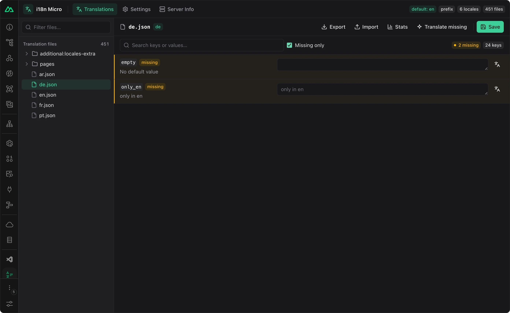
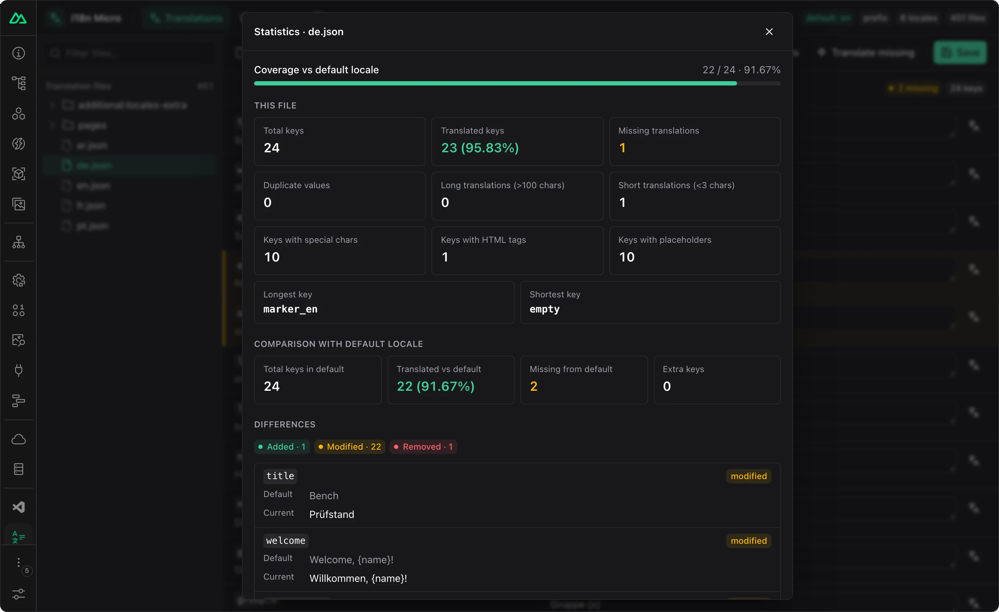
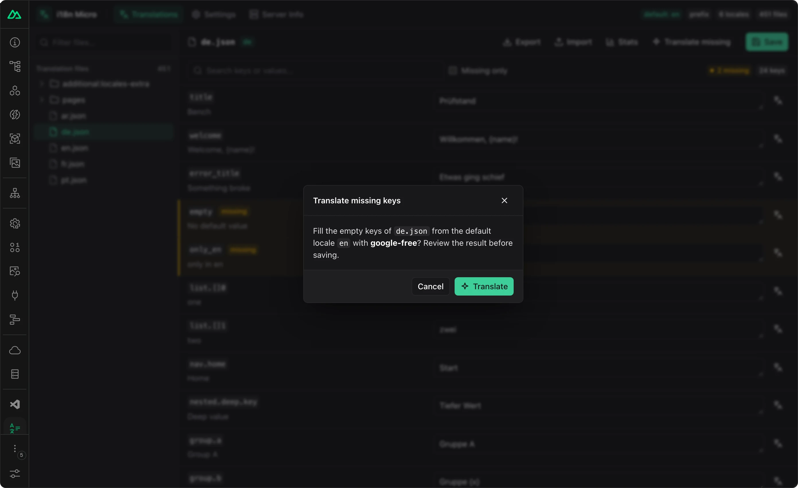
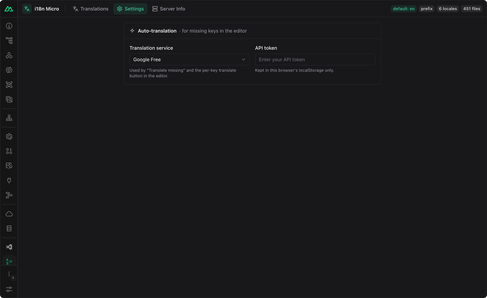

In `nuxt dev` fügt das Modul zwei Debugging-Hilfen hinzu: einen **i18n Micro**-Tab in Nuxt DevTools zum Durchsuchen und Bearbeiten von Übersetzungsdateien sowie einen Vue-DevTools-Inspector für die aktive Locale und die geladenen Wörterbücher. Beide existieren nur in der Entwicklung und fügen Produktions-Builds nichts hinzu. Der Nuxt-Tab benötigt nur aktivierte Nuxt DevTools; der Vue-Inspector benötigt zusätzlich die Vue-DevTools-Browsererweiterung.

## Nuxt-DevTools-Tab {#nuxt-devtools-tab}

```ts
// nuxt.config.ts
export default defineNuxtConfig({
  modules: ['nuxt-i18n-micro'],
  devtools: { enabled: true }, // the tab is registered only when DevTools are on
})
```

Öffnen Sie Nuxt DevTools (`Shift + Alt + D`) und wählen Sie **i18n Micro**. Der Tab zeigt:

- jede JSON-Datei unter `locales/` (Root und `pages/`) jeder Layer sowie Root-Dateien aus `additionalTranslationDirs`;
- einen Editor pro Datei; **Save** schreibt die Datei zurück auf die Festplatte, und der Dev-Server lädt die Übersetzungen neu;
- **Export** / **Import** einer Datei als JSON sowie **Stats** mit Schlüsselanzahlen und Übersetzungsabdeckung;
- eine Konfigurationsansicht der aufgelösten Moduloptionen;
- **Translate**, das fehlende Schlüssel mit einer maschinellen Übersetzungs-Engine füllt, die Sie in den Einstellungen des Tabs konfigurieren.

Beim Speichern werden nur bestehende `.json`-Dateien innerhalb Ihrer Übersetzungsverzeichnisse geschrieben. Existiert eine Datei in mehreren Layern, wird die Kopie des Projekts geschrieben.

<Tabs>

<Tab title="Editor">


</Tab>

<Tab title="Nur fehlende">



</Tab>

<Tab title="Statistik">



</Tab>

<Tab title="Übersetzen">



</Tab>

<Tab title="Einstellungen">



</Tab>

<Tab title="Serverinfo">


</Tab>

<Tab title="Große Projekte">


</Tab>

<Tab title="Helles Design">


</Tab>

</Tabs>

## Vue-DevTools-Inspector {#vue-devtools-inspector}

Mit der Vue-DevTools-Browsererweiterung registriert das Modul einen i18n-Inspector (aktuelle Locale, Routen-Chunk, geladene Schlüssel) und eine Timeline mit Locale-Wechseln, Chunk-Ladevorgängen und fehlenden Schlüsseln.

```ts
// nuxt.config.ts
export default defineNuxtConfig({
  modules: ['nuxt-i18n-micro'],
  i18n: {
    debug: true, // also log every $t / $ts / $tc call on the timeline
    // vueDevtools: false, // turn the inspector off, keep the Nuxt tab
  },
})
```

[`vueDevtools`](/de/api/module-options) ist standardmäßig `true`. `debug: true` ist sehr ausführlich; verwenden Sie es nur für kurze Sitzungen.

## Außerhalb von Nuxt {#outside-nuxt}

Dieselbe Oberfläche ist als [`@i18n-micro/devtools-ui`](/de/integrations/devtools-ui-package) für Vite-Apps veröffentlicht, die auf den Framework-Paketen aufbauen; die Einrichtung ist auf jener Seite beschrieben.

## Verwandte Themen {#related}

<CardGroup cols={2}>

<Card title="Übersetzungsdateien" icon="book-open" href="/de/guide/translations">

</Card>

<Card title="DevTools-UI-Paket" icon="boxes-stacked" href="/de/integrations/devtools-ui-package">

</Card>

<Card title="CLI" icon="book-open" href="/de/guide/cli">

</Card>

</CardGroup>
