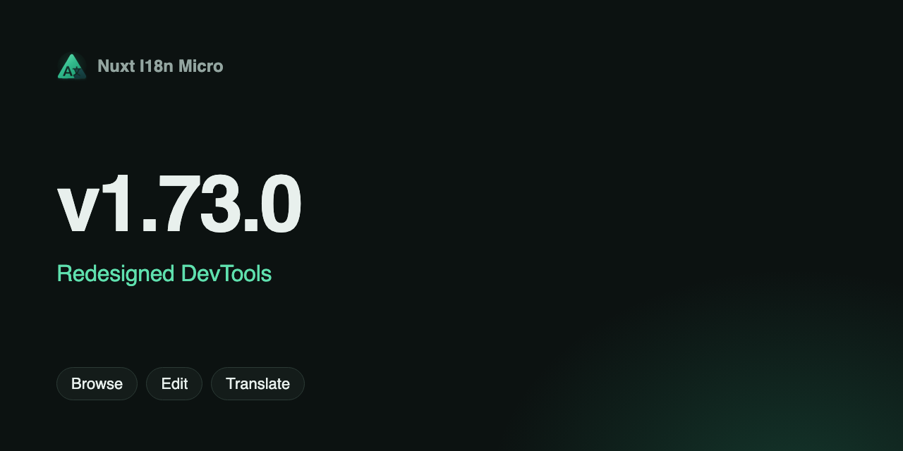

**Date** : 2025-01-27

**Version** : `v1.73.0`

Nous sommes ravis de vous présenter les **DevTools entièrement repensés** de la **v1.73.0**, qui apportent une expérience moderne et intuitive à votre flux de travail i18n! Cette mise à jour introduit de nouvelles fonctionnalités puissantes, une meilleure facilité d'utilisation et une foule d'améliorations pour simplifier la localisation et la gestion des traductions.

## Quoi de neuf? {#what’s-new}

1. Nouvel éditeur
2. Visionneuse d'arborescence de fichiers
3. Traducteur en ligne
4. Paramètres améliorés
5. Statistiques avancées
