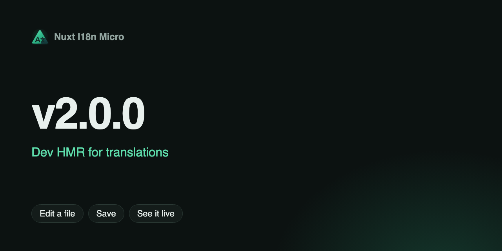

**Data**: 2025-10-30

**Versione**: `v2.0.0`



Introduciamo l'HMR lato server per i file di traduzione in sviluppo. Quando una traduzione JSON cambia, la cache del server invalida solo le chiavi interessate e le richieste successive ricevono subito i dati aggiornati, senza bisogno di riavvii.

## Cosa c'è di nuovo? {#what’s-new}

- HMR lato server per i file di traduzione
- Invalidazione istantanea della cache per pagina/locale
- DX fluida durante la modifica dei contenuti

## Come funziona {#how-it-works}

- Il watcher in `src/runtime/server/plugins/watcher.dev.ts` osserva `<rootDir>/<translationDir>/**/*.json`
- I file di pagina (ad es. `pages/<page>/<locale>.json`) invalidano `_locales:merged:<page>:<locale>`
- I file a livello root (ad es. `<locale>.json`) invalidano tutte le chiavi unite per quel locale
- Registrato automaticamente da `src/module.ts` in sviluppo quando `experimental.hmr !== false`

## Configurazione {#configuration}

```ts
export default defineNuxtConfig({
  i18n: {
    experimental: { hmr: true }, // default in dev
  },
})
```
