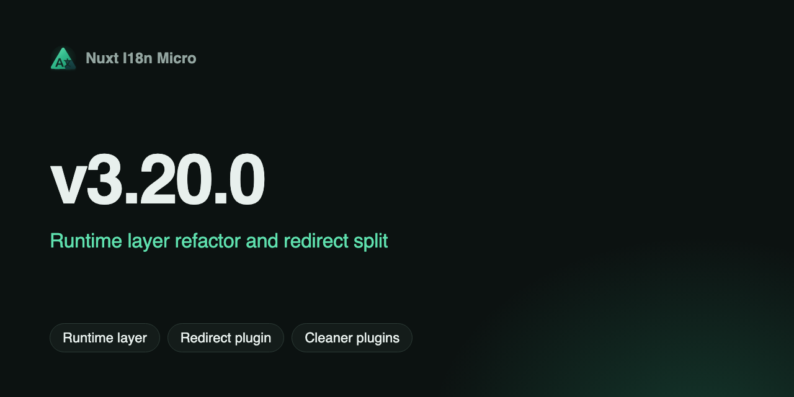

**Data**: 2026-05-14

**Versão**: `v3.20.0`

Esta versão refatora o runtime do Nuxt em uma camada dedicada **`NuxtI18n`**, separa o tratamento de redirecionamentos entre servidor e cliente e corrige várias regressões de SSR/hidratação. Os composables públicos e as opções do `nuxt.config` permanecem os mesmos para aplicações típicas.

## O que há de novo? {#what’s-new}

### `NuxtI18n` e `NuxtTranslationLoader` {#nuxti18n-&-nuxttranslationloader}

A lógica de i18n em tempo de execução sai do plugin monolítico e passa para classes focadas:

- **`NuxtI18n`** — camada de visualização das traduções ativas (`$t`, `$has`, contexto de locale/rota, mesclagem/limpeza nas transições)
- **`NuxtTranslationLoader`** — carrega chunks, troca o contexto na navegação, alimenta o payload do SSR
- **`createNuxtI18nPluginApi`** — superfície enxuta do plugin (`$switchLocale`, `$localeRoute` etc.)

Veja a [Arquitetura de cache e armazenamento](https://s00d.github.io/nuxt-i18n-micro/v3/api/i18n-cache-api) e [Desempenho](/pt-BR/guide/performance) atualizados.

### Payload do SSR via `useState('i18n-ssr-chunks')` {#ssr-payload-via-usestate‘i18n-ssr-chunks’}

As traduções do SSR são serializadas por meio do **estado do Nuxt**, e não por uma tag script `window.__I18N__`:

1. O servidor carrega os chunks → `useState('i18n-ssr-chunks')`
2. O cliente hidrata → `translationStorage.seedFromSsrChunks()`
3. Nenhuma requisição extra na primeira renderização

O caminho legado de leitura de `window.__I18N__` foi **removido**.

### Separação da arquitetura de redirecionamento {#redirect-architecture-split}

Os redirecionamentos agora são específicos de cada ambiente, para um comportamento mais claro e menos instabilidade no cliente:

| Ambiente       | Componente                     | Função                                     |
| -------------- | ------------------------------ | ------------------------------------------ |
| **SSR no servidor** | `06.redirect.ts` (somente servidor) | 302 antes da renderização, verificações de 404, sincronização de cookie |
| **SPA no cliente** | `i18n-redirect.global.ts`      | Middleware global de rota na navegação     |

Os redirecionamentos no cliente derivam o locale da **rota de destino**, preservam a **query string e o hash** e respeitam `redirects: false` (middleware não registrado). Veja [Detecção de locale — redirecionamentos por estratégia](/pt-BR/guide/locale-detection#redirects-per-strategy).

### Momento do hook `i18n:register` {#i18nregister-hook-timing}

O plugin **`05.hooks`** (`dependsOn: i18n-plugin-loader`) dispara `i18n:register` depois que o loader está pronto — na inicialização e na navegação — para que os plugins do usuário recebam o evento de forma confiável. Desative com `hooks: false`. Veja [Eventos](/pt-BR/api/events).

### Extração de `defineI18nRoute` em tempo de build {#build-time-definei18nroute-extraction}

Um unplugin do Vite analisa os arquivos `.vue` das páginas em tempo de build e grava os metadados de rota para `@i18n-micro/route-strategy`. O `$defineI18nRoute` em tempo de execução dentro de `script setup` continua disponível para desenvolvimento e configuração inline. Veja [Traduções por componente](/pt-BR/guide/per-component-translations).

## Correções de bugs {#bug-fixes}

- **Hidratação do SSR** — clona os chunks reativos do SSR antes de `Object.freeze` (corrige falhas de `#locale` / 404 no cliente)
- **Troca de locale** — substitui a camada de visualização na mudança de locale (sem chaves obsoletas do locale anterior)
- **Redirecionamento no cliente** — locale obtido da rota de destino; query/hash preservados no redirecionamento
- **`has()`** — verifica apenas o locale ativo; o fallback se aplica em `$t()`, não em `$has()`
- **Metadados de `defineI18nRoute`** — cache por instância do plugin; correspondência de `rootDir` mais longa; caminhos corretos de `pages/index` vs `pages/index/index`

## Documentação {#documentation}

Guias e referência da API atualizados para a nova arquitetura:

- [Estratégia](/pt-BR/guide/strategy), [Atualização para v3](https://s00d.github.io/nuxt-i18n-micro/v3/guide/v3-upgrade), [Detecção de idioma personalizada](/pt-BR/guide/custom-auto-detect)
- [FAQ — trocar o locale sem mudar a URL](/pt-BR/guide/faq#can-i-switch-locale-without-changing-the-url?)
- [Configuração](https://s00d.github.io/nuxt-i18n-micro/v3/guide/configuration) — comportamento de `redirects` e `hooks`

## Mudanças incompatíveis {#breaking-changes}

Nenhuma para o uso padrão de `nuxt.config` + composables. Os caminhos internos e o mecanismo de injeção do SSR mudaram; aplicações que dependiam da injeção manual de `window.__I18N__` devem usar o payload do Nuxt / as APIs do módulo.

## Por que isso importa {#why-it-matters}

- **Passagem SSR → cliente mais confiável** — estado nativo do Nuxt em vez de globais improvisadas
- **Modelo de redirecionamento mais claro** — 302 no servidor antes da renderização; middleware no cliente apenas onde necessário
- **Mais fácil de manter** — runtime dividido em unidades testáveis com testes de regressão focados

O changelog completo será publicado com a versão no [GitHub](https://github.com/s00d/nuxt-i18n-micro/blob/main/CHANGELOG.md).

---
