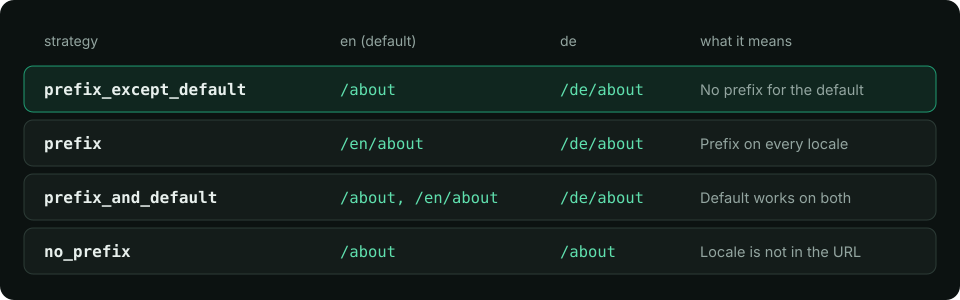

Опция `strategy` определяет, появляется ли локаль в URL и для каких локалей. Выберите её один раз, до публикации URL: её последующее изменение меняет все ссылки. Затем модуль генерирует локализованные маршруты во время сборки, а `$localePath`, `<i18n-link>` и переключатель читают их.

## Четыре стратегии {#the-four-strategies}



**Тип** `Strategies` · **По умолчанию** `'prefix_except_default'`

Стратегия маршрутизации URL для префиксов локалей.

- `'no_prefix'` — локали нет в URL; локаль хранится в cookie.
- `'prefix_except_default'` — префикс у всех локалей, кроме локали по умолчанию.
- `'prefix'` — префикс всегда, включая локаль по умолчанию.
- `'prefix_and_default'` — как `prefix`, но локаль по умолчанию также доступна без префикса.

URL для страницы `about` при `defaultLocale: 'en'` и локалях `en`, `de`:

| Стратегия | Английский | Немецкий | Не обслуживается |
| --- | --- | --- | --- |
| `prefix_except_default` (по умолчанию) | `/about` | `/de/about` | `/en` и `/en/about` дают 404 |
| `prefix` | `/en/about` | `/de/about` | `/about` перенаправляет на URL с префиксом |
| `prefix_and_default` | `/about` и `/en/about` | `/de/about` | — |
| `no_prefix` | `/about` | `/about` | локали нет в URL |

```ts
// nuxt.config.ts
export default defineNuxtConfig({
  modules: ['nuxt-i18n-micro'],
  i18n: {
    locales: [
      { code: 'en', iso: 'en-US' },
      { code: 'de', iso: 'de-DE' },
    ],
    defaultLocale: 'en',
    strategy: 'prefix',
  },
})
```

Стратегия фиксируется при сборке: её переопределение во время выполнения игнорируется с предупреждением ([Переопределения во время выполнения](/ru/guide/runtime-overrides)).

## Какую выбрать {#which-one-to-choose}

- **`prefix_except_default`**: большинство сайтов. Существующие URL без префикса продолжают работать для языка по умолчанию.
- **`prefix`**: все языки равноправны; `/` всегда ведёт на главную страницу с префиксом.
- **`prefix_and_default`**: нужно, чтобы работали и `/en/...`, и URL без префикса, например при переходе с одного варианта на другой. URL без префикса никогда не перенаправляются.
- **`no_prefix`**: приложения за авторизацией или один URL на страницу для всех языков. Локаль берётся из cookie или `?locale=`. Поисковые системы видят один язык на URL, поэтому альтернативы `hreflang` не выводятся.

Как выбирается локаль для URL и когда посетителя перенаправляют, описано в разделе [Определение локали](/ru/guide/locale-detection).

## Генерируемые маршруты {#generated-routes}

Во время сборки каждая страница получает записи маршрутов, которые нужны её стратегии. Каждая запись содержит `meta.i18n = { name, locales }`: страницу, которую она показывает, и локали, которые она обслуживает. Ссылки, переключения и перенаправления определяются по этим записям, поэтому URL, выдаваемый модулем, — всегда тот, который обслуживает роутер.

Локали, у которых путь страницы совпадает, используют одну запись: `/:locale(de|fr)/about`. Локаль с собственным путём получает собственную запись с именем `localized-<page>-<locale>`:

```ts
// nuxt.config.ts: German has its own path for the about page
i18n: {
  globalLocaleRoutes: { about: { de: '/ueber-uns' } },
}
// prefix_except_default, locales en (default), de, fr:
// about                 /about
// localized-about       /:locale(fr)/about
// localized-about-de    /:locale(de)/ueber-uns
```

Пользовательские пути, списки локалей для отдельных страниц и исключение страницы из локализации описаны в разделах [Локализованные пути](/ru/guide/custom-locale-routes) и [Конфигурация страницы](/ru/guide/per-component-translations). Префикс `localized-` задаётся опцией [`localizedRouteNamePrefix`](/ru/api/module-options#localizedroutenameprefix).

<Warning>

**Имена маршрутов генерируются** — не прописывайте имена `localized-…` жёстко в `router.push({ name })`. Передавайте собственное имя страницы в `$localeRoute` или `<i18n-link>`; они сами выберут нужную запись.

</Warning>

## Ссылка на страницу в локали {#linking-to-a-page-in-a-locale}

```vue
<script setup lang="ts">
const { localePath, localeRoute, switchLocalePath } = useI18n()

localePath({ name: 'about' }) // '/de/ueber-uns' while the page is German
localePath({ name: 'about' }, 'en') // '/about'
localePath('/about', 'de') // '/de/ueber-uns': a path is read as the page it shows
localeRoute({ name: 'products-id', params: { id: '42' } }, 'de') // resolved route: name, params, fullPath
switchLocalePath('fr') // the current page in French
</script>

<template>
  <i18n-link :to="{ name: 'about' }">{{ $t('nav.about') }}</i18n-link>
  <NuxtLink :to="$switchLocalePath('de')">Deutsch</NuxtLink>
</template>
```

- Работают и именованные маршруты, и пути. Путь сопоставляется со сгенерированными маршрутами, поэтому принимается его форма для любой локали.
- Локаль, которая не обслуживает страницу (см. `locales` в разделе [Конфигурация страницы](/ru/guide/per-component-translations)), ссылается на главную страницу этой локали, а не на отсутствующую страницу.
- Параметры для отдельных локалей (переведённый slug) передаются через `$setI18nRouteParams`, см. [Локализованные пути](/ru/guide/custom-locale-routes).

Сигнатуры приведены в разделе [Методы](/ru/api/methods).

## Подробности `no_prefix` {#no_prefix-details}

- [`localeCookie`](/ru/api/module-options#localecookie) при `no_prefix` по умолчанию равен `'user-locale'`, поэтому выбор сохраняется после перезагрузки.
- `$switchLocale('de')` загружает немецкий словарь и заменяет текущую запись истории; URL не меняется.
- Пользовательские пути для отдельных локалей по-прежнему работают: с `globalLocaleRoutes: { about: { de: '/ueber-uns' } }` немецкоязычные читатели получают `/ueber-uns`. Этот URL всегда рендерится на немецком, что бы ни предпочитал посетитель, а страница, ограниченная некоторыми локалями, рендерится в одной из них. Путь, общий для нескольких локалей (`en` и `de` оба на `/page/:id`), рендерится в предпочтительной локали, если она входит в их число. Само предпочтение сохраняется: следующая страница возвращается к нему.
- [`noPrefixRedirect: true`](/ru/api/module-options#noprefixredirect) перенаправляет исходный путь страницы, у которой есть пользовательский путь в локали по умолчанию: на пользовательский путь локали посетителя, а иначе — локали по умолчанию (`/about` → `/about-us`, когда у `en` есть `/about-us`, → `/ueber-uns` при cookie `de`). Локаль без собственного пользовательского пути остаётся на исходном пути и рендерится там. Страницы с параметрами не перенаправляются.

## Приложения без `pages/` {#apps-without-pages/}

При `pages: false` нет маршрутов страниц для локализации. Используйте только корневые файлы переводов (`disablePageLocales: true`); определение локали, cookie и `$switchLocale` по-прежнему работают. Рабочая конфигурация — вариант `pages-false` в `test/fixtures/basic` в репозитории.

## Связанные материалы {#related}

<CardGroup cols={2}>

<Card title="Локализованные пути" icon="book-open" href="/ru/guide/custom-locale-routes">

</Card>

<Card title="Исключение путей" icon="book-open" href="/ru/guide/excluding-static-files">

</Card>

<Card title="SEO" icon="book-open" href="/ru/guide/seo">

</Card>

</CardGroup>
