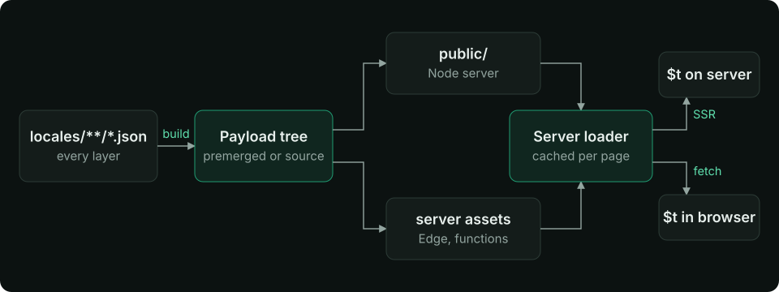

Översättningar är vanliga JSON-filer: en rotfil per locale för delade nycklar, och en fil per sida och locale för den sidans nycklar. Läs detta när du lägger till sidor, delar nycklar mellan dem eller konfigurerar reservlocales. Du får veta vilken fil en nyckel ska ligga i, vad en sida kan se och när varje fil läses in.

## Struktur {#layout}

```text
locales/
├── en.json                 # root: menus, footer, buttons
├── de.json
└── pages/
    ├── index/              # pages/index.vue
    │   ├── en.json
    │   └── de.json
    ├── about/              # pages/about.vue
    │   ├── en.json
    │   └── de.json
    └── products-id/        # pages/products/[id].vue
        ├── en.json
        └── de.json
```

- Mappen under `locales/pages/` är sidans Nuxt-**route-namn**: `pages/products/[id].vue` blir `products-id`, `pages/blog/[slug]/comments.vue` blir `blog-slug-comments`.
- Nycklar kan nästlas till valfritt djup; `$t('auth.form.login')` läser `{ "auth": { "form": { "login": … } } }`.
- `translationDir` flyttar mappen (`'locales'` som standard, relativt till projektroten, även under Nuxt 4:s `app/`-struktur).
- Saknade filer skapas som `{}` när Nuxt löser upp sidorna, såvida inte [`disableWatcher`](/sv/api/module-options#disablewatcher) är satt.

## Vad en sida ser {#what-a-page-sees}


En sidas ordlista är dess rotfil sammanslagen med dess sidfil, på djupet (varje nivå). Sidfilen vinner vid en konflikt:

```json
// locales/en.json
{ "title": "My shop", "nav": { "home": "Home", "cart": "Cart" } }
```

```json
// locales/pages/about/en.json
{ "title": "About us", "nav": { "cart": "Basket" } }
```

```ts
// on /about
t('title') // 'About us'
t('nav.home') // 'Home'   (root)
t('nav.cart') // 'Basket' (page wins)
// on any other page
t('title') // 'My shop'
```

En sida utan egen mapp får enbart rotordlistan. Nycklar från andra sidor syns inte.

### Reservlocales {#fallback-locales}

En nyckel som saknas i den aktiva locale:n hämtas från dess reservlocale innan själva nyckeln visas:

```ts
// nuxt.config.ts
export default defineNuxtConfig({
  modules: ['nuxt-i18n-micro'],
  i18n: {
    locales: [
      { code: 'en', iso: 'en-US' },
      { code: 'de', iso: 'de-DE' },
      { code: 'de-at', iso: 'de-AT', fallbackLocale: 'de' },
    ],
    defaultLocale: 'en',
    fallbackLocale: 'en', // global, for every locale
  },
})
```

- En locales egen `fallbackLocale` följs till slutet: `de-at` → `de` → `en`.
- Den globala `fallbackLocale` är det svagaste lagret, under varje kedja.
- Varje locale i kedjan lägger till sin rotfil och sedan sin sidfil, från den svagaste reservlocale:n upp till den aktiva locale:n. Den aktiva locale:ns rotfil vinner alltså över en reservlocales sidfil.

Utan reservlocale renderas en saknad nyckel som nyckeln (`'nav.home'`) och en varning loggas i webbläsarkonsolen i dev-läge ([`missingWarn`](/sv/api/module-options#missingwarn)).

## Delning och andra källor {#sharing-and-other-sources}

| Behov | Alternativ |
| --- | --- |
| Bara rotfiler, inga `pages/`-mappar | [`disablePageLocales: true`](/sv/api/module-options#disablepagelocales) |
| Två sidor läser en och samma sidmapp | [`routesLocaleLinks`](/sv/api/module-options#routeslocalelinks): `{ 'about-us': 'about' }` |
| Delade rotfiler i en annan mapp | [`additionalTranslationDirs`](/sv/api/module-options#additionaltranslationdirs): `['common']` (huvudmappen `translationDir` vinner) |
| Nycklar från ett Nuxt-lager | Lagrens filer slås ihop, projektets egna filer vinner. Se [Lager](/sv/guide/layers) |
| Nycklar som läggs till vid körning | hooken [`i18n:register`](/sv/api/events), `$mergeTranslations`, `$setTranslation` |
| Nycklar direkt i en sidkomponent | `$defineI18nRoute({ locales: { en: { … } } })`, se [Sidkonfiguration](/sv/guide/per-component-translations) |

## Hur en sida läser in sin ordlista {#how-a-page-loads-its-dictionary}



Modulen bygger en payload per sida och locale: `/{apiBaseUrl}/{page}/{locale}/data.json` (`/_locales/about/de/data.json` som standard).

1. **Serverrendering.** Nitro identifierar locale och sidan läser in sin payload direkt från serverladdaren, utan HTTP-förfrågan. Ordlistan skrivs inte in i HTML-payloaden, så sidorna förblir små.
2. **Hydrering.** Webbläsaren hämtar samma payload. Servern har redan genererat en `<link rel="preload">` för den, så hämtningen startar tillsammans med HTML:en.
3. **Navigering.** Nästa sidas payload ersätter ordlistan. Den lämnande sidans nycklar löses fortfarande upp tills den är borta (slutet av sidövergången, eller `page:finish`), så att en sida som tonas ut inte blixtrar fram råa nycklar. En chunk som inte kan läsas in (nätverksfel, 4xx eller 5xx, en body som inte är ett objekt) lämnar den aktuella ordlistan kvar, och nästa navigering läser in den igen. Ett misslyckat byte av locale fungerar likadant: `$switchLocale` returnerar `false`, och om du anropar den igen, eller klickar på väljaren igen, görs ett nytt försök. Under prefix-strategierna har URL:en redan bytts vid det laget, så `lang` och `$getLocale()` anger URL:ens locale medan de gamla texterna står kvar på skärmen.
4. **Cache.** Inlästa payloads cachas på servern och i webbläsaren; [Prestanda](/sv/guide/performance) har inställningarna för storlek och TTL.

`translationPayloads.mode` avgör hur payloads byggs. `'premerged'` (standard) skriver varje fil för sida × locale vid byggtid. `'source'` behåller källfilerna och slår ihop per förfrågan, vilket är mindre för stora kataloger på Edge-mål. Båda ger samma ordlistor. Var filerna hamnar för varje driftsättningsmål finns under [Driftsättning](/sv/guide/deployment).

## Redigering under utveckling {#editing-in-development}

`nuxt dev` läser filerna live. När du sparar en översättningsfil uppdateras den öppna sidans ordlista på plats: ingen omladdning, borttagna nycklar försvinner och en ändring i en rotfil når alla sidor. En trasig JSON-fil loggar en varning med sin sökväg och behandlas som tom. Sätt [`hmr: false`](/sv/api/module-options#hmr) för att uppdatera manuellt i stället.

## Relaterat {#related}

<CardGroup cols={2}>

<Card title="Sidkonfiguration" icon="book-open" href="/sv/guide/per-component-translations">

Locales per sida och inbäddade översättningar

</Card>

<Card title="Metoder" icon="brackets-curly" href="/sv/api/methods">

`$t`, `$tc`, `$tn`, `$td`

</Card>

<Card title="Driftsättning" icon="book-open" href="/sv/guide/deployment">

</Card>

</CardGroup>
