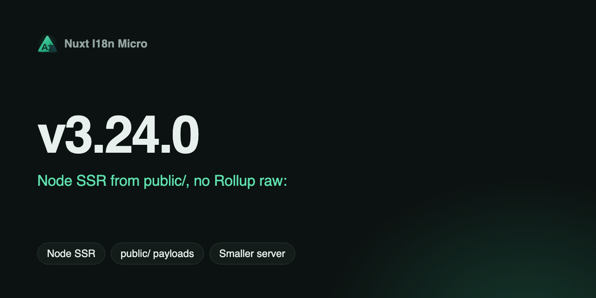

**Дата**: 2026-07-30

**Версія**: `v3.24.0`

Продакшн-збірки для Node більше не вбудовують payload перекладів як Nitro `serverAssets` / Rollup `raw:` (кілька ГБ RSS під час збірки на великих каталогах). SSR читає те саме дерево `/{apiBaseUrl}/{page}/{locale}/data.json`, яке завантажує клієнт, — з `public/` через `readFile`. Edge зберігає вбудовування Nitro і має віддавати перевагу `mode: 'source'`.

## Що нового? {#what’s-new}

### Node: SSR з `public/<apiBaseUrl>` {#node-ssr-from-public/&lt;apibaseurl&gt;}

- Пресети Node, які віддають `public/` з диска, **не** реєструють Nitro `serverAssets`.
- Payload копіюються в `public/<apiBaseUrl>` (за замовчуванням `_locales`) як `{page}/{locale}/data.json`.
- SSR завантажує їх через `#i18n-internal/payload-source` → `readFile` (продакшн-шлях поруч із `.output/server`).
- `translationPayloads.serverAssets: true` і далі означає «локальний SSR» і **примусово** вмикає цю публічну копію, навіть якщо `publicAssets` має значення false.

Playground (порівняно з попереднім вбудовуванням `serverAssets`): ~**1.25 GB** / ~6–7 с / `raw`=0 проти ~**3 GB** / ~13 с / ~170 raw-чанків.

### Edge: `serverAssets` лише за потреби {#edge-serverassets-only-when-needed}

- Edge (`nitro.node === false`) і далі вбудовує через Nitro `serverAssets` (`assets:i18n`) з тією самою структурою, що й `mode`.
- Edge **не** примушує створювати публічну копію — задайте `publicAssets: true` для CDN/статики.
- Видає попередження для Edge + `mode: 'premerged'` (для великих каталогів віддавайте перевагу `mode: 'source'`).

### `publicDir` узгоджено з клієнтськими URL {#publicdir-aligns-with-client-urls}

- `translationPayloads.publicDir` за замовчуванням дорівнює **`apiBaseUrl`** (а не `translationDir`).
- Попередньо об'єднане дерево public/Edge має вигляд `{page}/{locale}/data.json`, що відповідає `$fetch('/_locales/...')`.
- Значення модуля за замовчуванням більше не задають вкладене `publicAssets: true` (глибоке злиття Nuxt примусово вмикало публічну копію навіть для `mode: 'source'`).

Див. [Опції модуля — `translationPayloads`](/uk/api/module-options#translationpayloads), [Розгортання — serverless та Edge](/uk/guide/deployment#serverless-and-edge) і [Архітектура кешу та сховища](https://s00d.github.io/nuxt-i18n-micro/v3/api/i18n-cache-api).

## Несумісні зміни {#breaking-changes}

- **Жодних словників у HTML payload Nuxt SSR.** `payload.data['i18n-ssr-chunks']`, `setSsrChunk` і `seedFromSsrChunks` **видалено**. Та сама поведінка за замовчуванням, що й у `@nuxtjs/i18n` (`experimental.preload: false`): сервер тримає переклади в пам'яті для SSR; клієнт завантажує `/{apiBaseUrl}/.../data.json` під час налаштування плагіна (`await switchContext`).
- **`prerenderRoutes` за замовчуванням має значення `false`.** Вмикайте лише тоді, коли потрібно, щоб Nitro матеріалізував маршрути обробника, якщо `publicAssets` ще не записав дерево (попередньо об'єднаний `publicAssets` уже створює `{page}/{locale}/data.json`).
- **`publicDir` за замовчуванням — `apiBaseUrl`**, а не `translationDir`. Статичний вивід переміщується, наприклад, з `public/locales/...` до `public/_locales/{page}/{locale}/data.json`, якщо ви явно не задали `publicDir`.
- **Структура попередньо об'єднаного сховища** тепер `{page}/{locale}/data.json` (було `pages/{page}/{locale}.json`). Усе, що читало ключі Nitro/сховища або копіювало дерева за старою структурою, потрібно оновити.
- **У Node `serverAssets: true` більше не означає вбудовування Nitro** — це означає локальний SSR через публічну копію. Справжнє вбудовування Rollup `raw:` залишається лише для Edge.

## Міграція {#migration}

1. Видаліть будь-який код, що читав `payload.data['i18n-ssr-chunks']` або викликав `seedFromSsrChunks` / `setSsrChunk`.
2. Для суто статичних хостингів: залиште за замовчуванням premerged + `publicAssets` (файли потрапляють до `/_locales/.../data.json`) або задайте `prerenderRoutes: true` / розмістіть payload на CDN.
3. Для Cloudflare / інших Edge: задайте `translationPayloads: { mode: 'source' }` для великих каталогів; додавайте `publicAssets: true`, лише якщо потрібна статична/CDN-копія.
4. Якщо ви покладалися на payload у `public/<translationDir>`, задайте `translationPayloads.publicDir` або спрямуйте інструменти на `public/<apiBaseUrl>`.

## Виправлення: пропуск вимкнених локалей у попередньо об'єднаних публічних payload {#fix-skip-disabled-locales-in-premerged-public-payloads}

`preMergeLocales` тепер записує `{page}/{locale}/data.json` лише для локалей, переданих у злиття (локалі з `locale.disabled: true` на етапі збірки пропускаються). Раніше кожна JSON-локаль на диску копіювалася до `public/`, тож статичний сервер Nitro віддавав вимкнені локалі з кодом 200 в обхід обробника. `disabledLocales` часу виконання і далі не може скасувати публікацію вже зібраних файлів — використовуйте `locale.disabled` під час збірки, коли ввімкнено `publicAssets` / публічну копію для Node SSR.

## Чому це важливо {#why-it-matters}

- Збірки для Node залишаються легкими: жодних стрибків Rollup `raw:` на кілька ГБ через каталоги перекладів.
- Публічні файли та клієнтські URL `$fetch` мають одну структуру шляхів — статичний хостинг працює без спеціального переназначення.
- Edge і далі може вбудовувати компактні payload `source` без примусового дублювання публічного дерева.

Повний список змін буде опубліковано разом із випуском на [GitHub](https://github.com/s00d/nuxt-i18n-micro/blob/main/CHANGELOG.md).

---
