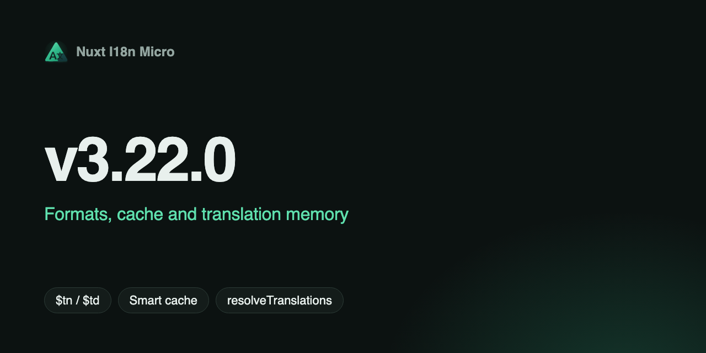

## Nuxt I18n Micro v3.22.0 — Formatlar, kesh va Translation Memory {#nuxt-i18n-micro-v3-22-0-—-formats-cache-&-translation-memory}

**Sana**: 2026-07-30

**Versiya**: `v3.22.0`

**v3.22.0** versiyasini e'lon qilamiz: formatlovchi keshiga ega Vue I18n uslubidagi nomlangan son/sana formatlari, CDN uchun qulay tarjima payload keshlash (kontent barmoq izi + `httpCacheDuration`) hamda runtime'da faol lug'atni o'qish va almashtirish uchun Translation Memory API.

## Nima yangi? {#what’s-new}

### Nomlangan `numberFormats` / `datetimeFormats` + formatlovchi keshi {#named-numberformats-/-datetimeformats-+-formatter-cache}

Vue I18n bilan mos nomlangan formatlar va tezroq Intl formatlash:

- Konfiguratsiya: har bir locale uchun `numberFormats` / `datetimeFormats`
- API: `$tn(1000, 'currency')`, `$td(date, 'short')` (+ locale'ni qayta belgilash va sozlamalarni birlashtirish)
- `FormatService` `Intl.NumberFormat` / `DateTimeFormat` / `RelativeTimeFormat` obyektlarini locale+sozlamalar bo'yicha keshlaydi

[Metodlar — `$tn` / `$td`](/uz/api/methods#$tn) va [Modul sozlamalari](/uz/api/module-options#numberformats) sahifalariga qarang.

### `dateBuild` standart holatda kontent barmoq izidan foydalanadi {#datebuild-defaults-to-a-content-fingerprint}

`/_locales` so'rovlaridagi `?v=` ilgari standart holatda `Date.now()` qiymatini olardi, javoblar esa bir yil davomida `immutable` sifatida berilardi. Shu sababli har bir qayta yig'ish, hech qanday tarjima o'zgarmagan bo'lsa ham, har bir mijozning lug'atini bekor qilardi.

Endi standart qiymat — qatlamlar tartibidagi tarjima manbalarining SHA-256 barmoq izi. Tarjimalar o'zgarmagan qayta yig'ishlarda URL o'zgarmaydi. `dateBuild` aniq belgilansa, u baribir ustun turadi. [Modul sozlamalari — `dateBuild`](/uz/api/module-options#datebuild) sahifasiga qarang.

### `/_locales` payload'lari uchun `httpCacheDuration` {#httpcacheduration-for-/_locales-payloads}

O'rnatilgan `/{apiBaseUrl}/:page/:locale/data.json` marshruti endi brauzerlar va CDN uchun HTTP `Cache-Control` sarlavhasini yuboradi:

- Sozlama: `httpCacheDuration` (soniyalarda, standart `31536000` / 1 yil)
- Sarlavha: `Cache-Control: public, max-age=…, immutable`
- Mavjud `dateBuild` kesh-bekor qilish (`?v=...`) bilan xavfsiz; `0` sarlavhani o'chiradi; development rejimida qo'llanilmaydi

`@nuxtjs/i18n` v10.2.0 dagi `experimental.httpCacheDuration` ning aniq javob sarlavhasi ko'rinishidagi analogi.

### Siqilgan ommaviy payload'lar {#compressed-public-payloads}

`nitro.compressPublicAssets` endi public katalogiga nusxalangan tarjima payload'lariga ham ta'sir qiladi (`.gz` + `.br`). Nitro ommaviy resurslarni nusxalashdan oldin siqadi, shuning uchun ilgari payload'lar statik yig'ishning yagona siqilmagan qismi edi — playground indeksida 6.65 MB xom holatda, 1.01 MB gzip bilan. Modul hamon siqishni o'zi yoqmaydi. [Unumdorlik](/uz/guide/performance#payload-size) sahifasiga qarang.

### `resolveTranslations()` va `setTranslation(key, value)` {#resolvetranslations-and-settranslationkey-value}

Xotiradagi faol tarjima lug'atini o'qish va almashtirish uchun runtime yordamchilari:

- **`resolveTranslations()`** faol locale va marshrut uchun `$t()` o'qiydigan to'liq daraxtni qaytaradi — DevTools, testlar va runtime muharrirlari uchun foydali. Ikkinchi qatlam faol bo'lganda (zaxira locale yoki Nuxt sahifa o'tishidagi hot-reload), dump `mergeTranslationLayers` orqali ichma-ich tuzilmani saqlaydi va faqat bitta daraxt boshqacha ifodalay olmaydigan skalyar-va-obyekt to'qnashuvlari uchun tekis nuqtali kalitlardan foydalanadi.
- **`setTranslation(key, value)`** kalitdagi qiymatni almashtiradi (yuqori daraja, nuqtali yo'l, obyekt, satr yoki skalyar). Bu birlashtirish emas, **almashtirish**; qo'shni qiymatlar saqlanishi kerak bo'lsa, `$mergeTranslations` dan foydalaning.
- `useI18n()`, `useNuxtApp()` va `@i18n-micro/core` dan meros olingan freymvork i18n nusxalarida mavjud.
- `@i18n-micro/test-utils` unit testlar uchun mos `resolveTranslations` / `setTranslation` yordamchilarini qo'shadi.

### `getAllTranslations()` Vue paketidan olib tashlandi {#getalltranslations-removed-from-vue-package}

Faol qidiruv daraxti uchun `resolveTranslations()` dan foydalaning. Vue'da xotirani to'liq dump qilish uchun `getStorage()` yoki `getRouteCache()` dan foydalaning.

## Buzuvchi o'zgarishlar {#breaking-changes}

Odatiy foydalanishda ommaviy konfiguratsiyadagi hech narsa ilova kodini o'zgartirishni talab qilmaydi. Agar runtime ichki qismlariga murojaat qilgan bo'lsangiz, quyidagilar muhim:

- **SSR payload `useState('i18n-ssr-chunks')` dan `nuxtApp.payload.data['i18n-ssr-chunks']` ga ko'chirildi.** U hamon SSR vaqtida yuklangan har bir `(locale, route)` uchun **to'liq tarjima bo'laklarini** olib yuradi — avvalgidek bir xil lug'atlar, lekin Nuxt prerender vaqtida `_payload.json` ga chiqarib qo'ya oladigan joyda. `useState('i18n-ssr-chunks')` endi hech narsa qaytarmaydi. Tarjimalarni shu yo'l bilan o'qish hech qachon qo'llab-quvvatlanmagan, lekin bu kesh API hujjatlarida tasvirlangani uchun bu yerda alohida qayd etilmoqda.
- **`NuxtTranslationLoaderOptions` `setSsrChunk` ni taqdim etadi.** Yuklovchi serverda har bir birlashtirilgan bo'lakni yuklash jarayonida `payload.data` ga yozadi. `getSsrChunks` ishlatilmaydi.
- **`nitro.compressPublicAssets` endi nusxalangan payload'lar yonida `.gz` / `.br` fayllarini yaratadi.** Agar u yoqilgan bo'lsa, public chiqishida ko'proq fayllar bo'lishini kuting. Tarjima katalogini sanab chiqadigan deploy vositalari ularni hisobga olishi kerak bo'lishi mumkin.
- **Payload URL'lari yangilanishda bir marta o'zgaradi**, chunki `?v=` yig'ish vaqt belgisidan kontent barmoq iziga o'tadi. Mijozlar yangilanishdan keyingi birinchi so'rovda lug'atni qayta yuklab oladi va keyin uni keyingi deploy'lar davomida saqlab qoladi — maqsad ham aynan shu.
- **`getAllTranslations()` `@i18n-micro/vue` dan olib tashlandi.** Uning o'rniga `resolveTranslations()` / `getStorage()` / `getRouteCache()` dan foydalaning.

## Xatolar tuzatildi {#bug-fixes}

- **`<i18n-switcher>`** — `disabled: true` bo'lgan locale'larni ochiladigan ro'yxatdan chiqarib tashlaydi. `$getLocales()` o'z kodingiz uchun hamon to'liq ro'yxatni qaytaradi, o'rnatilgan SEO/meta chiqishi esa o'chirilgan locale'larni chiqarib tashlaydi.
- **Switcher uslublari** — `cursor: not-allowed` `activeLinkStyle` / `customActiveLinkStyle` orqali **joriy** locale'ga qo'llaniladi; orqaga moslik uchun `customDisabledLinkStyle` qaytarildi va joriy locale `disabled: true` bo'lganda u switcher tugmasiga qo'llaniladi.
- **Dev HMR** — fayl mazmunini o'zgartirmaydigan yozish (muharrirning fokusdan chiqqanda saqlashi, formatlovchining qayta yozishi) endi qayta birlashtirishni ishga tushirmaydi. Ildiz locale o'zgarishlari shu locale uchun barcha sahifalarni qayta yig'adi, shuning uchun buni hech narsa o'zgarmagan holatga sarflash qimmatga tushardi.
- **Dev HMR** — ildiz locale o'zgarganda sahifalar ketma-ket emas, parallel ravishda qayta birlashtiriladi.
- **Sahifa o'tishlari** — bir xil locale ichidagi navigatsiya har bir o'tishda qimmat chuqur birlashtirish o'rniga chiqib ketayotgan bo'lakni `page:transition:finish` gacha zaxira qatlam sifatida saqlaydi.

## Nima uchun bu muhim {#why-it-matters}

- Og'irroq stekni qo'shmasdan Vue I18n uslubidagi formatlash.
- Lug'at o'zgarmaganda qayta yig'ishlar davomida barqaror qoladigan, CDN uchun qulay tarjima URL'lari.
- Jonli lug'atni tekshirish va tuzatish uchun qo'llab-quvvatlanadigan runtime API — DevTools, testlar va muharrirlarga endi yopiq yordamchilar kerak emas.

To'liq o'zgarishlar jurnali reliz bilan birga [GitHub](https://github.com/s00d/nuxt-i18n-micro/blob/main/CHANGELOG.md)da e'lon qilinadi.

---

## Tuzatish: `app.baseURL` + `strategy: 'prefix'` bilan cheksiz qayta yo'naltirish sikli (#234) {#fix-infinite-redirect-loop-with-app-baseurl-+-strategy-‘prefix’-#234}

**Sana**: 2026-07-03

Server tomonidagi qayta yo'naltirish plagini (`06.redirect.ts`) endi locale'ni aniqlashdan oldin `getRequestURL(event).pathname` dan `runtimeConfig.app.baseURL` ni olib tashlaydi. Ilova quyi yo'l ostida xizmat qilganda yuzaga keladigan `ERR_TOO_MANY_REDIRECTS` tuzatildi (masalan, `/examples` → `/examples/ja` bir marta, `/examples/ja/examples/ja/...` emas).
