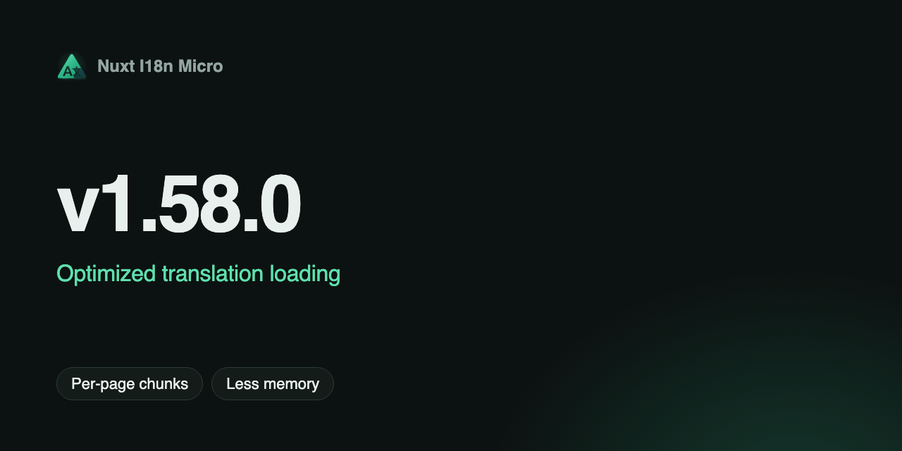

**Ngày**: 2025-01-10

**Phiên bản giới thiệu**: `v1.58.0`

Chúng tôi rất vui mừng thông báo phát hành **thuật toán mới để tải bản dịch** trong Nuxt I18n Micro. Bản cập nhật này mang lại những cải thiện đáng kể về hiệu năng, kiến trúc gọn gàng hơn và sử dụng bộ nhớ hiệu quả hơn.

## Có gì mới? {#what’s-new}

Thuật toán tải bản dịch mới tập trung vào:

1. **Hợp nhất tệp được tối ưu hóa**: Cải tiến chức năng deep merge để xử lý bản dịch hiệu quả hơn.
2. **Cải tiến bộ nhớ đệm**: Tận dụng server storage cho các bản dịch được pre-render, giảm các phép tính dư thừa.
3. **Mã nguồn tinh gọn**: Đơn giản hóa đường dẫn tệp và cấu trúc để dễ bảo trì hơn.

---

## Lợi ích chính {#key-benefits}

### **1. Thời gian build nhanh hơn** {#1-faster-build-times}

Thuật toán mới giảm thời gian build nhờ xử lý hiệu quả các tệp bản dịch và giảm thiểu chi phí bộ nhớ.

- **Thời gian build cũ**: 7.20 giây
- **Thời gian build mới**: 6.91 giây
- **Cải thiện**: **nhanh hơn 4.03%**

### **2. Giảm mức sử dụng CPU** {#2-reduced-cpu-usage}

Mức sử dụng CPU tối đa và trung bình thấp hơn trong quá trình build và stress test:

- **CPU tối đa khi build**: Từ **257.60%** → **198.20%** (thấp hơn 23.06%)
- **CPU trung bình khi stress test**: Từ **93.85%** → **89.14%** (thấp hơn 5.01%)

### **3. Sử dụng bộ nhớ thấp hơn** {#3-lower-memory-usage}

Mức tiêu thụ bộ nhớ đã được tối ưu hóa đáng kể trong cả quá trình build và stress test lúc chạy:

- **Bộ nhớ tối đa khi build**: Từ **1286.00 MB** → **885.19 MB** (thấp hơn 31.15%)
- **Bộ nhớ tối đa khi stress test**: Từ **624.22 MB** → **429.52 MB** (thấp hơn 31.20%)

### **4. Thời gian phản hồi được cải thiện** {#4-enhanced-response-times}

Thời gian phản hồi trong stress test được cải thiện đáng kể:

- **Thời gian phản hồi trung bình**: Từ **411.50 ms** → **9.30 ms** (nhanh hơn 97.74%)
- **Thời gian phản hồi tối đa**: Từ **2723.00 ms** → **187.00 ms** (nhanh hơn 93.13%)

### **5. Tăng thông lượng yêu cầu** {#5-increased-request-throughput}

Thuật toán mới tăng số lượng yêu cầu được xử lý mỗi giây:

- **Số yêu cầu mỗi giây**: Từ **288.00** → **305.00** (tăng 5.90%)

---

## Tại sao điều này quan trọng {#why-it’s-important}

Bản địa hóa là yếu tố thiết yếu đối với các ứng dụng toàn cầu, và việc cải thiện hiệu năng tải bản dịch có thể tác động trực tiếp đến:

- **Trải nghiệm người dùng**: Thời gian phản hồi nhanh hơn mang lại trải nghiệm mượt mà hơn.
- **Khả năng mở rộng**: Sử dụng ít tài nguyên hơn giúp xử lý lưu lượng truy cập cao tốt hơn.
- **Năng suất của nhà phát triển**: Thời gian build ngắn hơn và codebase đơn giản hơn giúp tinh gọn quy trình làm việc.

---

## Cách hoạt động {#how-it-works}

1. **Deep merge hiệu quả**

- Thuật toán đã được viết lại để xử lý việc hợp nhất bản dịch thông minh hơn, đảm bảo chi phí bộ nhớ tối thiểu và thao tác nhanh hơn.

2. **Bộ nhớ đệm thông minh**

- Server-side storage giờ đây được dùng để lưu đệm bản dịch trong quá trình pre-render, sau đó được tái sử dụng lúc chạy. Điều này tránh việc đọc và hợp nhất lặp đi lặp lại.

3. **Tải tệp tinh gọn**

- Các tệp bản dịch được tải theo cách dễ dự đoán và dễ bảo trì hơn nhờ thống nhất cách xử lý fallback và bộ nhớ đệm.
