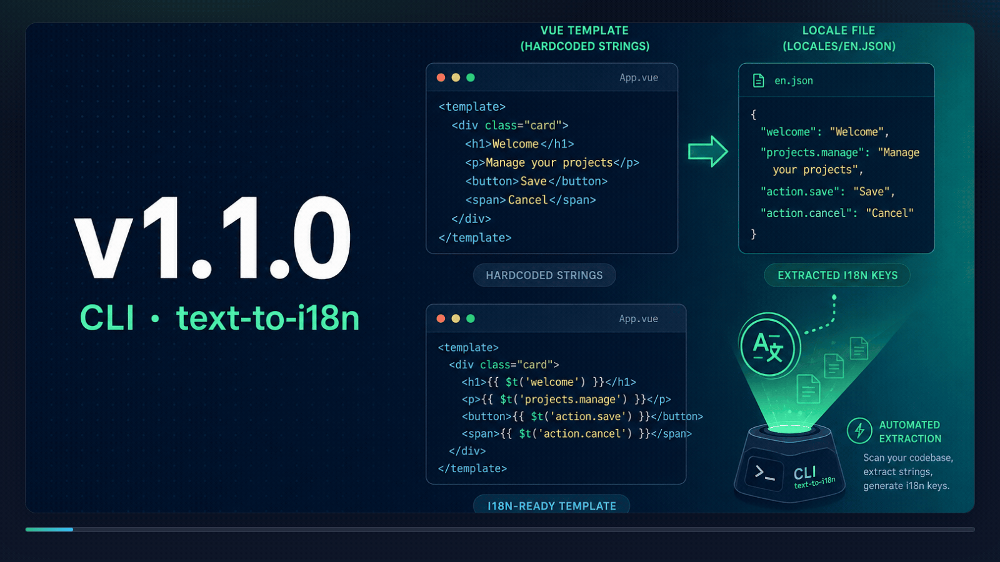

**日期**：2024-12-24

**引入的 CLI 版本**：`v1.1.0`



我们很高兴地宣布 Nuxt I18n Micro CLI 新增了 `text-to-i18n` 命令！这一强大功能可以自动从代码库中提取硬编码的文本字符串，并将其转换为 i18n 翻译键。它旨在节省时间、减少错误，并简化你的本地化工作流程。

## 主要优势 {#key-benefits}

- **自动提取文本**：扫描 Vue 模板、JavaScript 和 TypeScript 文件。
- **无缝生成键**：根据文件路径和内容创建结构化的翻译键。
- **高效管理翻译**：在保留现有条目的同时更新翻译文件。

## 工作原理 {#how-it-works}

1. **文件扫描**：处理 `pages`、`components` 和 `plugins` 等关键目录中的文件。
2. **文本处理**：识别并提取可翻译的字符串，生成唯一的键。
3. **翻译更新**：自动将新键插入翻译文件，并保持其嵌套结构。

## 用法 {#usage}

```bash
i18n-micro text-to-i18n [options]
```

示例：

```bash
i18n-micro text-to-i18n --translationFile locales/en.json --context auth
```

## 转换示例 {#example-transformations}

### 转换前 {#before}

```vue
<template>
  <div>
    <h1>Welcome to our site</h1>
    <p>Please sign in to continue</p>
  </div>
</template>
```

### 转换后 {#after}

```vue
<template>
  <div>
    <h1>{{ $t('pages.home.welcome_to_our_site') }}</h1>
    <p>{{ $t('pages.home.please_sign_in') }}</p>
  </div>
</template>
```

更多详情请查看[文档](/zh-Hans/guide/cli#turn-hardcoded-text-into-keys)。

---
