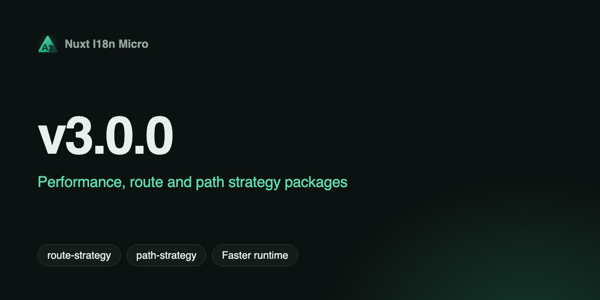

**日期**：2026-02-04

**版本**：`v3.0.0`



我们正式发布 **v3.0.0**，带来一次**重大架构改造**：为实现最高性能而完全重写了翻译存储系统，路由生成和运行时路径逻辑现已拆分到独立的包中，重定向流程也经过重新设计，以提升可靠性和 Serverless 兼容性。

## 新功能 {#what’s-new}

### 性能优化 — 全新的翻译存储架构 {#performance-optimization-—-new-translation-storage-architecture}

翻译加载和缓存系统已为实现最高性能而完全重写：

- **集中式 TranslationStorage 类** — 新的 `TranslationStorage` 类（`src/runtime/utils/storage.ts`）为客户端和服务端提供统一存储。它使用 `globalThis` 配合 `Symbol.for`，确保在整个 Node.js 进程中是真正的单例，防止在打包后的各模块之间重复缓存。

- **优化后的 `$t()` 函数（tFast）** — 翻译函数直接在单个活动字典中查找：
  1. 所有翻译（根级 + 页面专属 + 回退）都在构建时预先合并为每个页面一个文件
  2. 在同一 locale 内导航时，新页面的翻译会累积合并到活动字典中（避免过渡动画期间键闪烁）
  3. 支持嵌套键（`key.subkey.subsubkey`），并对路径解析进行了优化
  4. 每次调用都无需 Map 查找或 locale/路由计算 — 使用预先计算的上下文

- **通过 `window.__I18N__` 进行服务端注入** — SSR 期间加载的翻译会以 script 标签的形式注入到 HTML 中。客户端在首次加载时直接从 `window.__I18N__` 读取，避免重复请求。

- **插件中的本地分块缓存** — 插件维护一个本地 `loadedChunks` Map，用于存储所有已加载的翻译分块。翻译一旦加载，在页面生命周期内便不会再次请求。

- **构建时预合并** — `module.ts` 中的 `preMergeLocales` 步骤会在构建时将所有 layer、回退 locale 链和根级翻译合并到每个页面文件中。server-loader 只需读取一个预先构建的文件 — 无需运行时合并。

**性能提升：**

- 减少每个请求的内存分配（每次调用 `$t()` 都不再重新创建对象）
- 降低垃圾回收压力
- 负载下响应更快
- 内存使用模式稳定（图表不再"跳动"）

### Route 与 Path Strategy 包 {#route-&-path-strategy-packages}

- **@i18n-micro/route-strategy** — 构建时路由生成：为 Nuxt 页面扩展本地化路由，处理别名、嵌套路由以及各 strategy 下的自定义路径。单一入口：`new RouteGenerator(options)` 和 `extendPages(pages)`。各 strategy（`no_prefix`、`prefix`、`prefix_except_default`、`prefix_and_default`）以独立的类实现，并通过工厂进行选择。
- **@i18n-micro/path-strategy** — 运行时路径和 locale 处理：提供 `PathStrategy`，用于构建本地化路径、解析重定向和切换 locale。支持 tree-shaking 的子路径导出（`/prefix`、`/no-prefix` 等），因此只会打包所选的 strategy。使用纯函数进行路由解析，并使用预先计算的上下文标志以尽量减少内存分配。
- **结构化的包布局** — 路由逻辑位于 `@i18n-micro/route-strategy`，包含 `core/`、`strategies/`。路径 strategy 位于 `@i18n-micro/path-strategy`，采用扁平的 `src/` 结构：`types.ts`、`path.ts`、`resolver.ts`、`helpers.ts` 和 `strategies/`。
- **一致的行为** — 别名处理、父子路径拼接、自定义 `globalLocaleRoutes` / `filesLocaleRoutes` / `routeLocales` 以及不可变性保证都由专门的测试套件覆盖。

### 重定向架构改造 {#redirect-architecture-overhaul}

- **服务端中间件** — 重定向和 404 处理在 Nitro 中间件（`i18n.global.ts`）中运行。它在 Nuxt 渲染之前执行，因此当存在 locale cookie 时，从 `/` 到 `/<locale>/` 的重定向不会出现错误闪烁。
- **客户端插件（client-side）** — 一个仅在客户端运行的插件（`06.client-redirect.client.ts`）在 hydration 之后运行，并在 `useI18nLocale()` 或 cookie 设置了非默认 locale 时处理重定向。Nitro 在 Nuxt 之前运行，因此服务端无法看到用户插件对 cookie/state 的更改；客户端插件负责处理这种情况。
- **不再有回退组件** — `locale-redirect.vue` 回退组件和 `fallbackRedirectComponentPath` 选项已被移除。重定向逻辑完全由服务端中间件和客户端插件处理。
- **自定义路径支持** — 像德语的 `/kontakt` 这样的路径（通过 `globalLocaleRoutes`）现在可以在没有 locale 前缀的情况下被正确识别为有效路径，避免预渲染期间出现错误的 404。
- **customRegexMatcher 修复** — 使用 `customRegexMatcher` 时，模式现在会匹配**整个**首个路径段（带有 `^` 和 `$` 锚点）。这可以防止像 `/locale-test` 这样的路由出现误报 404，而之前模式 `[a-z]{2}-[a-z]{2}` 会匹配到子字符串。
- **autoDetectPath 修复** — `autoDetectPath` 选项现在会正确地与原始 URL 路径进行比较，避免在显式导航到带 locale 前缀的 URL 时发生不必要的重定向。

### useI18nLocale 组合式函数 {#usei18nlocale-composable}

- **集中式 locale 管理** — 新的 `useI18nLocale()` 组合式函数取代了 `useLocaleCookies`，为 locale 状态、cookie 和同步工具提供单一入口。
- **API** — `locale`、`localeCookie`、`hashCookie`、`getLocale()`、`getPreferredLocale()`、`setLocale()`、`syncLocale()`、`isValidLocale()`、`getEffectiveLocale()`、`resolveInitialLocale()`。
- **以编程方式设置 locale** — 在服务端插件中使用 `useI18nLocale().setLocale(locale)` 代替 `useState('i18n-locale')`，使 locale 处理更简洁、更集中。

### 自定义自动检测与配置 {#custom-auto-detection-&-configuration}

- **`getI18nConfig()`** — 自定义插件（例如用于 locale 检测的插件）应使用来自 `#build/i18n.strategy.mjs` 的 `getI18nConfig()`，而不是 `useRuntimeConfig().public.i18nConfig`。这样可以直接访问解析后的 i18n 配置（例如 `localeCookie`），而无需依赖运行时配置。
- **Cookie 名称** — 实现自定义检测逻辑时，请使用 `getI18nConfig().localeCookie ?? 'user-locale'`。

### 简化的集成包 {#simplified-integration-packages}

所有集成包（`@i18n-micro/vue`、`@i18n-micro/astro`、`@i18n-micro/node`、`@i18n-micro/react`、`@i18n-micro/preact`、`@i18n-micro/solid`）都经过简化和优化，并共享相同的核心翻译逻辑。

### 配置变更 {#configuration-changes}

- **移除 `previousPageFallback`** — 不再需要此选项。新的累积合并策略会在过渡动画期间自动保留上一页面的翻译，然后通过 `page:transition:finish` hook 进行清理。
- **`hmr`** — 从 `experimental.hmr` 移至顶层选项。用于控制翻译文件的服务端 HMR（开发环境下默认启用）。

```typescript
// Before (v2.x)
export default defineNuxtConfig({
  i18n: {
    experimental: {
      hmr: true,
    },
  },
})

// After (v3.0.0)
export default defineNuxtConfig({
  i18n: {
    hmr: true,
  },
})
```

## 破坏性变更 {#breaking-changes}

- **`fallbackRedirectComponentPath`** — 已移除。模块不再使用回退路由组件进行重定向。如果你配置了自定义组件路径，请将其从配置中移除。
- **`useLocaleCookies`** — 已移除。请改用 `useI18nLocale()`。新的组合式函数提供 `locale`、`localeCookie`、`hashCookie`、`setLocale()`、`syncLocale()` 等。
- **`experimental.i18nPreviousPageFallback` / `previousPageFallback`** — 已完全移除。累积合并策略会自动处理过渡时的闪烁问题。请将此选项从配置中移除。
- **`experimental.hmr`** — 已移至 `hmr`。如果你使用了此选项，请更新配置。
- **自定义插件** — 如果你的自定义 locale 检测插件使用了 `useRuntimeConfig().public.i18nConfig`，请改用来自 `#build/i18n.strategy.mjs` 的 `getI18nConfig()`。优先使用 `useI18nLocale().setLocale()` 而不是 `useState('i18n-locale')`。更新后的示例请参阅[自定义语言检测](/zh-Hans/guide/custom-auto-detect)。
- **内部文件变更** — `load-from-storage.ts` 和 `translation-loader.ts` 已被移除，并由 `storage.ts` 和 `server-loader.ts` 取代。如果你直接从这些文件导入（不推荐），请更新导入语句。

## 为何重要 {#why-it-matters}

- **性能**：集中式单例缓存消除了每个请求的对象创建，并降低了 GC 压力。
- **可维护性**：路由和路径逻辑位于独立的包中，边界和类型清晰。
- **测试**：strategy 的行为和边界情况可以独立测试。
- **可靠性**：将服务端（Nitro）和客户端重定向逻辑分离，避免了用户插件设置 cookie/useState 时的时序问题。
- **适用于 Serverless**：Nitro 插件与 Nitro 处理程序在同一上下文中运行，兼容 Edge/Workers。
- **文档**：路由行为记录在 [Strategy 指南](/zh-Hans/guide/strategy)以及 [path-strategy](https://github.com/s00d/nuxt-i18n-micro/tree/main/packages/path-strategy) 和 [route-strategy](https://github.com/s00d/nuxt-i18n-micro/tree/main/packages/route-strategy) 包中。

升级说明和完整的变更列表请参阅 [changelog](https://github.com/s00d/nuxt-i18n-micro/blob/main/CHANGELOG.md)。

---
