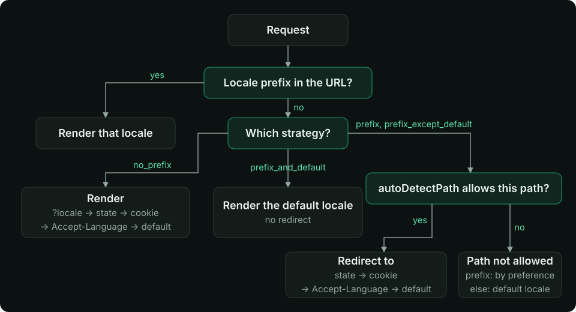

每个请求都会得到一个 locale，它在服务端和浏览器中按相同顺序从同一组来源中选出。当你需要决定首次访问者落在哪种语言、是否记住他们的选择，以及服务端 API 看到什么时，请阅读本页。你将了解优先级、每种策略的重定向行为，以及开启或关闭每个来源的选项。

<Tip>

**前置知识** — [路由策略](/zh-Hans/guide/strategy)

</Tip>

## 优先级 {#the-precedence}

第一个给出**已启用** locale 的来源胜出。无效或格式错误的值（未知代码、损坏的 cookie）会被跳过，由下一个来源决定。

| # | 来源 | 生效条件 |
| --- | --- | --- |
| 1 | URL 前缀（`/de/about`） | 前缀策略。在 `prefix_except_default` 和 `prefix_and_default` 下，无前缀 URL 即为默认 locale |
| 2 | `?locale=de` | 页面：仅 `no_prefix`。服务端 API 辅助函数：始终生效，且优先于 URL |
| 3 | 应用设置的 locale 状态（`useI18nLocale().setLocale()`） | URL 中没有 locale |
| 4 | Cookie | 设置了 [`localeCookie`](/zh-Hans/api/module-options#localecookie)（在 `no_prefix` 下自动为 `'user-locale'`） |
| 5 | `Accept-Language` 请求头 | [`autoDetectLanguage`](/zh-Hans/api/module-options#autodetectlanguage) 为 `true`（默认） |
| 6 | [`defaultLocale`](/zh-Hans/api/module-options#defaultlocale) | 始终 |

因此，在前缀策略下，由 URL 决定页面显示的内容；偏好来源（3–5）只决定访问者被**重定向**到哪里，并且只在 `autoDetectPath` 允许的路径上生效。在 `no_prefix` 下没有可重定向的内容，由偏好来源决定页面显示的内容。



## 各策略的重定向 {#redirects-per-strategy}

重定向为 `302`，在页面渲染前由服务端执行，客户端导航则由路由中间件执行。查询参数和 hash 会被保留。设置 [`redirects: false`](/zh-Hans/api/module-options#redirects) 后不会发生任何重定向；错误的前缀仍然返回 404。

访问者偏好 `de`（cookie 或请求头），`defaultLocale: 'en'`，默认 `autoDetectPath: '/'`：

| 请求 | `prefix_except_default` | `prefix` | `prefix_and_default` | `no_prefix` |
| --- | --- | --- | --- | --- |
| `/` | → `/de` | → `/de` | `/`，使用 `en` | `/`，使用 `de` |
| `/about` | `/about`，使用 `en` | → `/de/about` | `/about`，使用 `en` | `/about`，使用 `de` |
| `/fr/about` | `/fr/about` | `/fr/about` | `/fr/about` | — |
| `/en/about` | 404 | `/en/about` | `/en/about` | — |

`prefix_and_default` 从不重定向：无前缀 URL 属于默认 locale，其他 locale 位于各自的前缀下。在 `prefix_except_default` 下，偏好 `en` 的访问者不会从 `/` 被重定向。目标地址不带结尾斜杠（`/de`，而不是 `/de/`），并遵循自定义路径（`/about` → `/de/ueber-uns`）。

凡是由 cookie 或请求头决定的情况（从 `/` 的重定向、`no_prefix` 下的每个页面），响应都会带上 `Vary: Cookie, Accept-Language`，以便 CDN 将不同的响应分开缓存。

### `autoDetectPath` {#autodetectpath}

偏好来源可以在哪些位置移动访问者：

| 值 | 偏好生效的位置 |
| --- | --- |
| `'/'`（默认） | 仅 `/`。深层链接保持 URL 中的语言 |
| `'no_prefix'` | 所有不带 locale 前缀的路径（`/about` → `/de/about`） |
| `'/welcome'` | 该精确路径（忽略结尾斜杠） |
| `'*'` | 所有路径，包括带前缀的路径：访问者偏好 `de` 时，`/about` 和 `/fr/about` → `/de/about` |

- 在不允许的路径上，无前缀 URL 被视为默认 locale。
- `prefix` 是例外：它没有无前缀页面，因此 `/about` 始终跳转到访问者的 locale（cookie 为 `de` 时为 `/de/about`，无偏好时为 `/en/about`）。
- 使用 `'*'` 时，服务端会忽略应用的状态，带前缀的 URL 也不再将自身的 locale 记录到 cookie 中；只有当访问者通过 `$switchLocale` 切换时，cookie 才会改变。

<Warning>

使用 `'*'` 时，分享的链接会以读者的语言打开，这可能出乎意料。除非这正是你想要的，否则请优先使用 `'/'` 或 `'no_prefix'`。

</Warning>

## Accept-Language {#accept-language}

请求头按照 RFC 9110 的定义读取，并与配置中的 locale **代码**进行匹配：

- 条目按 `q` 值从高到低尝试（`fr;q=0.1, de;q=0.9` → `de`）。`q=0` 表示"不要这种语言"；`q` 格式错误的条目会被忽略。`*` 不匹配任何内容。
- `_` 被视为 `-`（`en_US` = `en-US`）。
- 对于每个条目：先尝试精确代码，再尝试更短的形式（`de-AT` → `de`），然后尝试同一语言的地区 locale（`en` → `en-US`）。精确形式和更短形式与 `locales` 的顺序无关；在多个地区匹配中，`locales` 中排在最前的胜出。
- 绝不跨越书写系统：`zh-TW` 和 `zh-HK` 意味着繁体，`zh-CN` 意味着简体，因此 `zh-CN` 永远不会匹配 `zh-Hant` locale。
- 已禁用的 locale 永远不会匹配。

```ts
// locales: [{ code: 'en' }, { code: 'de' }, { code: 'zh-Hant' }]
// 'de-CH,de;q=0.9,en;q=0.8'  → 'de'
// 'en-GB'                    → 'en'
// 'zh-TW'                    → 'zh-Hant'
// 'zh-CN'                    → no match, next source
```

使用 `autoDetectLanguage: false` 可关闭请求头检测；cookie 和状态仍然生效。

## Cookie {#the-cookie}

- 对于前缀策略，**默认关闭**（`localeCookie: null`）。此时重定向仅依赖请求头，且选择不会在多次访问之间被记住。设置 `localeCookie: 'user-locale'` 即可记住选择。
- 在 `no_prefix` 下，除非你设置了其他名称，否则它为 `'user-locale'`。在这里 `localeCookie: null` 同样可以将其关闭。
- 它会在访问者切换时写入（`$switchLocale`、`<i18n-switcher>`、`useI18nLocale().setLocale()`），以及在服务端渲染带前缀的页面时写入（`/fr/about` 会存储 `fr`；但在 `autoDetectPath: '*'` 且开启重定向时不会写入，因为此时 URL 仍可能变化）。客户端导航到某个页面时也会存储该页面的 locale，包括默认 locale 的无前缀页面；首次加载该 URL 则不会。在 `no_prefix` 和 hash 模式下，导航只会存储变化。404 不会存储任何内容，除非是 `$switchLocale` 跳转到了它。
- 有效期为一年（`path=/`、`SameSite=Lax`）。
- 在 `hashMode` 下，偏好改为保存在 `hash-locale` cookie 中；服务端和客户端读取的是同一个。服务端渲染该 locale，并且在 `prefix` 之外从不重定向；hash 中的 locale（`/#/de`）优先于它，并在水合后立即生效。在 `prefix` 下，`/` 上没有页面，因此 `/` 在浏览器中渲染，浏览器会根据 cookie、然后根据浏览器语言（`autoDetectLanguage`）跳转到 `/#/de`；其他任何文档（`/about`、`/de`）都会重定向到 hash 中。

请使用 [`useI18nLocale`](/zh-Hans/composables/useI18nLocale) 读取和设置偏好，而不要直接使用 `useCookie` 或 `useState`。

## 自定义检测 {#your-own-detection}

若要自行选择 locale（用户设置、子域名），请在一个先于模块插件运行的插件中调用 `useI18nLocale().setLocale(code)`。它会成为来源 3，即应用的状态。[自定义 locale 检测](/zh-Hans/guide/custom-auto-detect)提供了完整方案，包括如何关闭内置检测。

## 服务端 API 路由 {#server-api-routes}

[`useLocaleServerMiddleware`](/zh-Hans/guide/server-side-translations) 和 `useTranslationServerMiddleware` 使用自己的顺序，因为 API URL 很少被本地化：

1. `?locale=`
2. `[locale]` 路由参数，或路径中的 locale 前缀
3. cookie（设置了 `localeCookie` 时）
4. `Accept-Language`（开启 `autoDetectLanguage` 时）
5. `defaultLocale`

在这里，`localeCookie: null` 和 `autoDetectLanguage: false` 同样会关闭来源 3 和 4。

## 运行时覆盖 {#runtime-overrides}

[运行时覆盖](/zh-Hans/guide/runtime-overrides)会改变用于匹配来源的 locale 列表：

- 运行时 `disabledLocales` 会从每一步中移除：指向它们的 cookie 或请求头会被跳过。
- 在 `prefix` 和 `no_prefix` 下，运行时 `defaultLocale` 即为第 6 步。
- 在 `prefix_except_default` 和 `prefix_and_default` 下，默认 locale 在构建时固定（它的页面就是无前缀路由）。运行时 `defaultLocale` 或禁用构建时的默认 locale 都会被忽略并输出警告。

## 相关内容 {#related}

<CardGroup cols={2}>

<Card title="自定义 locale 检测" icon="book-open" href="/zh-Hans/guide/custom-auto-detect">

</Card>

<Card title="服务端路由和 API" icon="book-open" href="/zh-Hans/guide/server-side-translations">

</Card>

<Card title="useI18nLocale" icon="brackets-curly" href="/zh-Hans/composables/useI18nLocale">

</Card>

</CardGroup>
