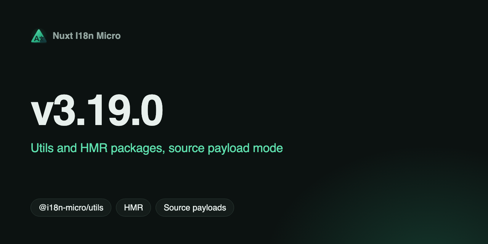

**日期**：2026-05-25

**版本**：`v3.19.0`



此版本著重於**將內部工具模組化**、新增**精簡的 serverless payload 模式**，以及在 Nuxt、Node、Astro 與 DevTools 之間**重複使用共用邏輯**，且一般應用程式的公開模組 API 維持不變。

## 有哪些新功能？ {#what’s-new}

### `@i18n-micro/utils` — 與框架無關的工具 {#@i18n-micro/utils-—-framework-agnostic-utilities}

先前分散在 `src/runtime/utils/` 與 `src/module.ts` 的共用邏輯，現在集中於專屬的 workspace 套件，並提供**細粒度的子路徑匯入**（沒有肥大的 barrel 檔，對 tree-shaking 友善）：

- **建置** — `preMergeLocales`、`buildTranslationSourceLayers`（`@i18n-micro/utils/build`）
- **Payloads** — `translationPayloads` 解析、URL 建構、fetch 輔助函式、統計（`payload-config`、`payload-url`、`payload-fetch`、`payload-stats`）
- **Source 模式** — 後備鏈、來源檔案路徑、執行階段合併（`merge-source`、`source-loader`）
- **執行階段輔助函式** — 語系解析、cookies、Accept-Language 解析、路由／meta 輔助函式（`resolve-locale`、`accept-language`、`cookie`、`route`、`route-pattern`、`runtime-config`）
- **共用 FS 路徑** — 翻譯檔案分類、巢狀頁面路徑（`parse-path`）

Nuxt 模組在 `src/runtime/` 中只保留輕量的銜接程式碼，並僅匯入所需的子路徑。

### `@i18n-micro/hmr` — 開發時的翻譯熱重載 {#@i18n-micro/hmr-—-dev-translation-hot-reload}

開發環境的 HMR 已抽離至 `@i18n-micro/hmr`：

- **`watcher`** — 處理檔案變更、快取失效，以及開發時的 source／premerged 合併
- **`generate-plugin`** — 產生用戶端 HMR 外掛
- **`cache-keys`** — 供伺服器／儲存空間快取使用的共用 `Symbol.for` 鍵

同時支援 `translationPayloads.mode: 'premerged'` 與 `'source'`。

### `translationPayloads.mode: 'source'` — 精簡的 Serverless 部署 {#translationpayloads-mode-‘source’-—-compact-serverless-deployments}

針對 serverless 平台（Cloudflare Workers 等）上大型語系矩陣的全新 payload 模式：

```typescript
export default defineNuxtConfig({
  i18n: {
    translationPayloads: {
      mode: 'source',
    },
  },
})
```

- 將**精簡的來源檔案**打包進 Nitro assets，而非完整的預先合併矩陣
- 透過內建的 `/_locales/:page/:locale/data.json` 路由，**在執行階段**合併根層級、頁面與後備語系鏈
- `publicAssets` 與 `prerenderRoutes` 預設為 `false` — 適合依賴 Nitro／edge 執行環境而非純靜態託管的情境

請參閱 [部署 — serverless 與 Edge](/zh-TW/guide/deployment#serverless-and-edge) 以及 [Cache & Storage Architecture](https://s00d.github.io/nuxt-i18n-micro/v3/api/i18n-cache-api)。

### 整合套件之間的共用工具 {#shared-utilities-across-integration-packages}

- **`@i18n-micro/node`** 與 **`@i18n-micro/astro`** — 透過 `@i18n-micro/utils/parse-path` 統一翻譯路徑解析與深層合併
- **`@i18n-micro/astro`** — 使用來自 `@i18n-micro/utils/accept-language` 的 `detectLocaleFromAcceptLanguage`（移除重複的解析器）
- **`@i18n-micro/devtools-ui`** — 透過 `merge-source` + `parse-path` 輔助函式產生虛擬檔案路徑
- **伺服器語系偵測** — Accept-Language 處理與共用工具保持一致

### HMR 與 DevTools 修正 {#hmr-&-devtools-fixes}

- 用戶端 HMR 外掛現在呼叫 **`$loadPageTranslations`**（正確的 API），而非已移除的 `$loadTranslations`
- 針對 **premerged** 與 **source** 模式下的翻譯 watcher 新增 Playwright 測試涵蓋

### 文件與貢獻者指南 {#documentation-&-contributor-guide}

- [Cache & Storage Architecture](https://s00d.github.io/nuxt-i18n-micro/v3/api/i18n-cache-api) — 說明兩種 payload 模式與套件邊界
- [伺服器端翻譯](/zh-TW/guide/server-side-translations)、[快速入門](/zh-TW/guide/getting-started)、[Folder Structure](https://s00d.github.io/nuxt-i18n-micro/v3/guide/folder-structure) — `premerged` 與 `source` 的注意事項
- [Contribution Guide](https://s00d.github.io/nuxt-i18n-micro/v3/guide/contribution) — Node 18+、pnpm 9+、Oxlint/Oxfmt，以及包含 `packages/utils` 與 `packages/hmr` 的 monorepo 架構

## 破壞性變更（進階／內部） {#breaking-changes-advanced-/-internal}

這些變更僅影響曾匯入**內部**模組路徑（不屬於公開 API）的專案：

- 自 `src/runtime/utils/` 移除：`route-utils.ts`、`runtime-i18n-config.ts`，以及其他已移至 `@i18n-micro/utils/*` 的工具
- 自 `src/runtime/server/plugins/` 移除：內嵌的 HMR watcher／generator — 若你 fork 了開發工具，請改用 `@i18n-micro/hmr/*`
- **`nuxt-i18n-micro`** 現在依賴 `@i18n-micro/utils` 與 `@i18n-micro/hmr` workspace 套件（會隨模組自動安裝）

一般的 `nuxt.config` + composables 用法維持不變。

## 為何重要 {#why-it-matters}

- **更小的 serverless 套件** — `source` 模式避免為每個語系 × 頁面都附上一份預先合併的檔案
- **單一事實來源** — 路徑解析、合併、語系偵測與 payload 設定只有一份實作
- **更易維護** — 與框架無關的程式碼在 `@i18n-micro/utils` 中測試（50+ 個單元測試），並在各處重複使用
- **更好的開發體驗** — HMR 邏輯獨立、可測試，且在各 payload 模式間行為一致

完整的提交清單請參閱 [changelog](https://github.com/s00d/nuxt-i18n-micro/blob/main/CHANGELOG.md)。

---
