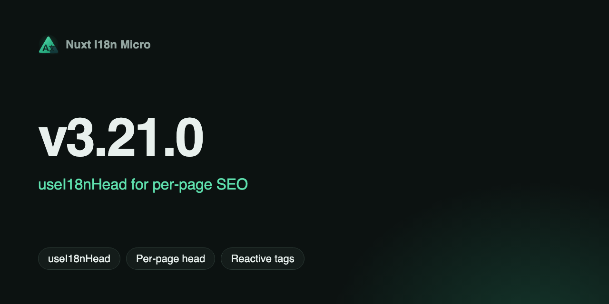

**日期**：2026-06-25

**版本**：`v3.21.0`



此版本新增 **`useI18nHead`** — 一個頁面層級的 composable，可在內建的 `02.meta` 外掛之上覆寫 i18n SEO 設定。你可以針對每個路由自訂 `hreflang`、canonical、`og:url` 與 Open Graph 標籤，而不需要自訂 meta 外掛或設定 `meta: false`。

## 有哪些新功能？ {#what’s-new}

### `useI18nHead` Composable {#usei18nhead-composable}

當 `meta: true`（預設值）時，可在任何頁面中呼叫 `useI18nHead`。模組會在每次路由更新時，於 `useLocaleHead` 之後合併你的輸入：

```vue
<script setup lang="ts">
useI18nHead(() => ({
  meta: [{ property: 'og:title', content: article.value?.title }],
  replace: {
    canonical: article.value?.canonicalUrl,
    ogUrl: article.value?.canonicalUrl,
    hreflang: localeCodes.map((locale) => ({
      rel: 'alternate',
      hreflang: locale,
      href: article.value!.locales[locale]!,
    })),
    ogAlternates: localeCodes,
  },
}))
</script>
```

支援靜態物件、響應式 getter、`meta` / `link` 附加、用於內建群組的 `replace`，以及用來移除自動產生標籤的 `disable`。請參閱 [`useI18nHead`](/zh-TW/composables/useI18nHead)。

### `mergeI18nHead` 工具函式（`@i18n-micro/utils`） {#mergei18nhead-utility-@i18n-micro/utils}

與框架無關的合併邏輯位於 `@i18n-micro/utils/merge-i18n-head` — 由 `02.meta` 外掛使用，並可獨立測試。型別（`I18nHeadInput`、`I18nHeadLink`、`I18nHeadMeta`）由 `@i18n-micro/types` 匯出。

### 外掛整合 {#plugin-integration}

- **`02.meta`** — 透過 `useHead` 將 `useLocaleHead` 的輸出與來自 `useI18nHead` 的頁面狀態合併
- **`01.plugin`** — 在路由名稱變更時透過 `resetPageHead()` 重設頁面覆寫（與 composable 共用狀態）

### 文件與測試 {#documentation-&-tests}

- 新指南：[`useI18nHead`](/zh-TW/composables/useI18nHead)，附 CMS／文章範例
- 更新 [SEO](/zh-TW/guide/seo) 與 [`useLocaleHead`](/zh-TW/composables/useLocaleHead) — 說明何時該使用哪個 API
- Playwright + Vitest 涵蓋範圍：SSR、SPA 導覽、重新載入、`nuxi generate`、部分替代語系、`x-default`、響應式用戶端載入

## 典型使用情境 {#typical-use-cases}

| 情境                                         | 做法                                                           |
| -------------------------------------------- | -------------------------------------------------------------- |
| 部分翻譯的部落格／CMS                        | 從 API 語系取得 `replace.hreflang` + `replace.ogAlternates`    |
| 來自 CMS 的自訂 canonical                    | `replace.canonical` + `replace.ogUrl`                          |
| 僅著陸頁的 OG                                | `meta: [{ property: 'og:title', ... }]` — 保留模組的 hreflang  |
| 頁面不需要 hreflang                          | `disable: ['hreflang', 'x-default']`                           |
| 取代自訂外掛（`i18nManualHreflang`）         | 在每個內容頁使用 `useI18nHead` + `meta: true`                  |

**JSON-LD** 仍保留在 `useHead({ script: [...] })` 中 — `useI18nHead` 不會產生結構化資料。

## 重大變更 {#breaking-changes}

標準的 `nuxt.config` 用法沒有任何重大變更。新的 composable 與 utils 子路徑皆為新增功能。

## 為什麼這很重要 {#why-it-matters}

- **不需要自訂 meta 外掛**，即可處理具有各語系 URL 的 CMS 文章、新聞或指南
- **單一管線** — 模組預設值 + 頁面覆寫在一次 `useHead` 呼叫中完成
- **型別安全** — 可將 `I18nHeadInput` 用於 `buildArticleHead(content)` 等輔助函式

完整的變更紀錄將隨版本發布於 [GitHub](https://github.com/s00d/nuxt-i18n-micro/blob/main/CHANGELOG.md)。

---
